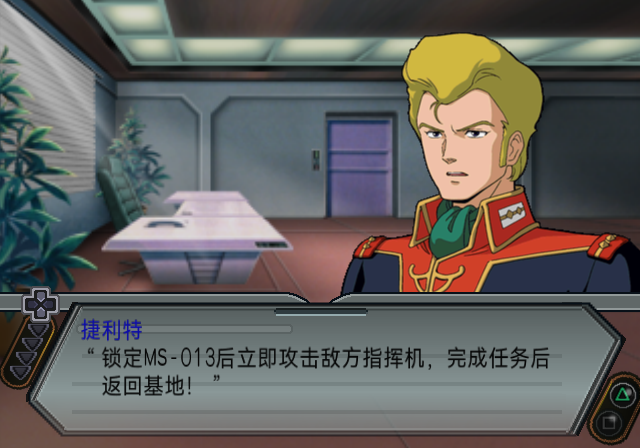
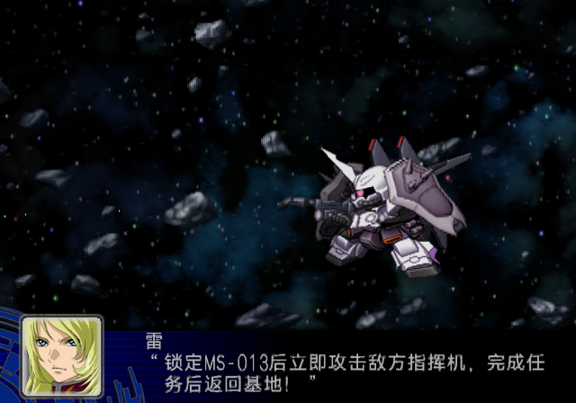

# 剧情和战斗紧缩英数：原生代码与 LRPS2 验证（2026-10-28）

## 结论

战斗普通中文横向 step 为 **22px**，与“每行只能使用 21 格”并不矛盾。21 是总格数预算，22 是每格推进量；战斗总预算 462px。剧情正文另用 step 21，本轮沿用已测的 23 格 / 483px 预算。引号和续行全角缩进均计入总预算，不能额外加一个结束引号格。

| 场景 | 普通字宽 / 高度 | 普通 step | 紧缩字宽 / 高度 | 紧缩 step | 结束后恢复 |
| --- | --- | --- | --- | --- | --- |
| 剧情 | 21 / 12 | 21 | 14 / 11 | 12 | W21 / H12 / step21 |
| 战斗 | 22 / 11 | 22 | 14 / 11 | 12 | W22 / H11 / step22 |

不能把剧情的 `</z>` 恢复参数直接用于战斗。这里测试时为同一个 `<z>` 语义分别传入场景恢复参数，不修改正式语料。

## 代码与自然运行证据

The Best 当前 ELF 的默认字体初始化，`0x139944` 装入 22，`0x13994C` 装入 11；`0x139958`、`0x139960`、`0x139968` 分别写入 glyph width、height、horizontal step。完整片段保存在 [battle-font-init.txt](issue-assets/mixed-compact-20261028/battle-font-init.txt)。这证明默认值，不单凭该初始化推断所有调用场景。

在插入任何测试控制符前，读取自然战斗字幕的原生字形记录：字体全局 `0x46EB30`，记录 0 为名字（Y72），记录 1 起为正文（Y84）。正文 X 从 -160、-138、-116、-94 递增，宽高 22/11，直接确认自然战斗使用 step22。屏幕起点 X160，总预算右端为 622；22 个完整中文格会达到 644，越过 640 像素屏幕。

剧情使用自身描述器，详见 [剧情原生宽度分析](STORY_DIALOGUE_NATIVE_LINE_WIDTH_20261028.md)。本轮自然正文记录宽高为 21/12。两场景都遵循文本显式换行；不把图集缓存的 UV 边界常量解释为文本自动折行宽度。

## 测试方法与结果

使用 LRPS2，从当前 SP ISO 启动剧情、当前 The Best ISO 进入实际战斗演出。各自先制作私有 ISO 副本，并核对 manifest SHA-256。然后仅临时替换当前活动 RAM 文本，交给游戏自己的字体解析和绘制代码；每次核对写入读回及字形记录，完成后还原原始 RAM。原始存档 SHA-256 前后相同。

每场景 5 例：普通英数对照、紧缩并按宽度断行、`Gundam01` 大小写混排、第二行 `MS-013` 紧缩后恢复中文、`013` 与 `80%` 多作用域。另补拍 3 例暗背景战斗。

- 剧情缓存逐行复用：核对各例末行，共 **61 个字形**的位置和宽高，全部通过。第二行恢复用例包含英数与恢复后的中文，避免仅检查中文末行。
- 战斗核对两行，共 **141 个字形**，全部通过；暗背景补拍 **89 个字形**全部通过。
- `MS-013` 从普通的剧情 126px / 战斗 132px 推进，缩至 72px；其后中文恢复本场景参数。
- 紧缩整句第一行推进量：剧情 471px（预算483），战斗446px（预算462），均未越界。保留完整标识符及标点断行约束，因此不要求每行恰好耗尽预算。
- 图中紧缩英数与后续中文未发现尺寸恢复错误、下沿突出或截断。这里是有限用例的实际渲染验证，不代表所有语料已验证。

当前复现为 SP 剧情和 The Best 战斗，没有把两例扩展称为三版所有场景运行验证；也没有写回正式文本或重建生产 ISO。

## 留存

[机器可读证据及输入 ISO / 存档哈希](issue-assets/mixed-compact-20261028/evidence.json)。本地对照页：`http://127.0.0.1:8766/mixed-compact/index.html`。

复现脚本和原始 RAM / 字形缓存位于 `work/analysis/mixed-compact-20261028/`、`work/runtime/lrps2/mixed-compact-20261028/`（本地实验产物）。

## 排版算法接入（同日后续）

已调整 `config/text-layout/zh-layout-profiles.json`：

- `story_dialogue`：step21，首行23格，续行正文22格 + 1格缩进，最多3行；总宽483px。
- 新增 `battle_subtitle`：step22，首行21格，续行正文20格 + 1格缩进，最多2行；总宽462px。
- 两者采用 `max_width`，先填满较早的行，再考虑断点评分。保留原有中文词表、标点禁则和完整紧缩标识符；不把梗概/滚动字幕的“可任意断词”扩大应用于对白。

`compact_scopes.BATTLE` 明确恢复22/11/22，排版包装器和 `renderer_metrics.text_extent` 在step22场景使用该参数；剧情保留21/12/21。计算紧缩段时同时考虑推进和字形矩形右缘（W14、step12意味着末字形多出2px）。

`battle_subtitle_line_widths`、`battle_subtitle_layout_issues` 用物理像素计算，不删除引号或缩进。`reflow_battle_subtitle` 接受语料中的字面 `\n`，默认保持字幕原有行数；不能在保持行数下放入时报告失败，不自动增加字幕行。它要求显式传入 `battle_subtitle` profile。低层通用算法未带profile时仍保留历史保守预算。

主篇构建、SP迁移及公共SRVC写入器均已支持按战斗参数展开 `<z>`，严格读回比较使用同一展开结果；SP规范化/迁移不再以“去掉引号后20字”判断宽度。未改写语料，也未重建发布ISO。

新增回归覆盖：两场景全部维度恢复、大小写/数字/百分数、引号与缩进、末字形2px外沿、保持字幕行数、原生SRVC字节编码，以及与本轮LRPS2铺满样本完全相同的换行和像素宽度。[算法输出样本](issue-assets/mixed-compact-20261028/layout-algorithm-results.json)。这些算法测试不能替代新的构建产物运行验收；对应样本的原生截图来自前面的RAM验证。

[现有战斗语料审计](issue-assets/mixed-compact-20261028/layout-corpus-audit.json)：本篇25708条中13条涉及未缩进或超过2行；SP123条中 `sd-battle:081` 为484px（22格，含引号），超过462px。均保留原文供后续处理；没有通过删除文字、自动改行数或放宽结束引号预算掩盖问题。

本轮算法相关测试66项通过（场景混排8、剧情词表/语料12、渲染宽度21、紧缩作用域11、SRVC写入4、SP对白8、宽度索引2）。本轮修改文件的 `git diff --check` 通过。

全套 `python3 -m unittest discover -s tests`：881项，144.932秒，OK（跳过1项）；日志：`work/analysis/mixed-compact-20261028/layout-full-tests.log`。

## 12条续行缩进统一（用户确认后）

用户查看LRPS2缩进对照后确认采用缩进。已在 `corpus/zh/battle/srvc-lines.json` 的12条记录中，各增加第二行开头一个全角空格；可见文字、原有控制符、换行数量/位置、记录元数据不变。逐条重新计算，全部在462px总预算内。未重建发布ISO。

[12条改动与宽度核对](issue-assets/battle-indent-20261028/indent-corpus-changes.json)。其余 `battle:06641` 三行和 `sd-battle:081` 超宽记录仍保留原文，单独展示与验证。

剩余两条已在同一个The Best LRPS2战斗窗口按原文临时回放：`battle:06641` 第三行被下沿裁切；`sd-battle:081` 的稀疏结束引号墨迹仍可见，但完整字格预算484px超过462px，不能据此放宽预算。不是各自自然触发场景或SP专属窗口验收。[回放截图与字形记录](issue-assets/battle-remaining-20261028/evidence.json)。测试RAM已还原，源存档未变。

## 最后两条重排与LRPS2复验

用户确认保留原文及缩进，将 `battle:06641` 从3行重排为2行，将 `sd-battle:081` 超宽单行改为2行。逐字检查仅换行/续行空格改变，文字和标点全部保留。前者与已核验SHA的日文源文均为2行，移除旧的额外换行许可；后者按本次确认增加1处换行许可，公共SRVC换行策略验证均通过。

- `battle:06641`：462 / 242px。
- `sd-battle:081`：374 / 132px。

使用The Best当前ISO启动后的同一LRPS2战斗窗口临时回放修改后的文本，55个原生字形位置/宽高全部匹配，截图两行均完整显示，无第三行下沿裁切。不是两条各自自然触发的战斗或SP专属场景验收；未重建发布ISO。测试RAM已还原，原始存档未变。

[文本修改与源文/宽度证据](issue-assets/battle-remaining-fixed-20261028/changes.json) · [LRPS2回放证据](issue-assets/battle-remaining-fixed-20261028/evidence.json) · [全量复查](issue-assets/battle-remaining-fixed-20261028/corpus-audit-after.json)。本篇25708条和SP123条共25831条，行宽/行数/续行缩进审计问题为0。
