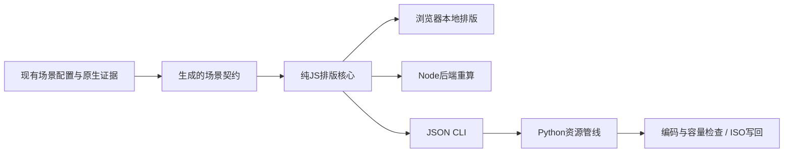
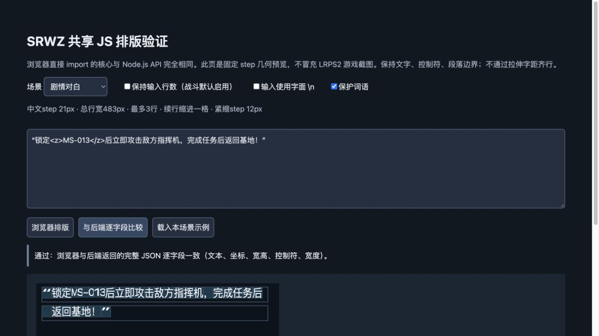
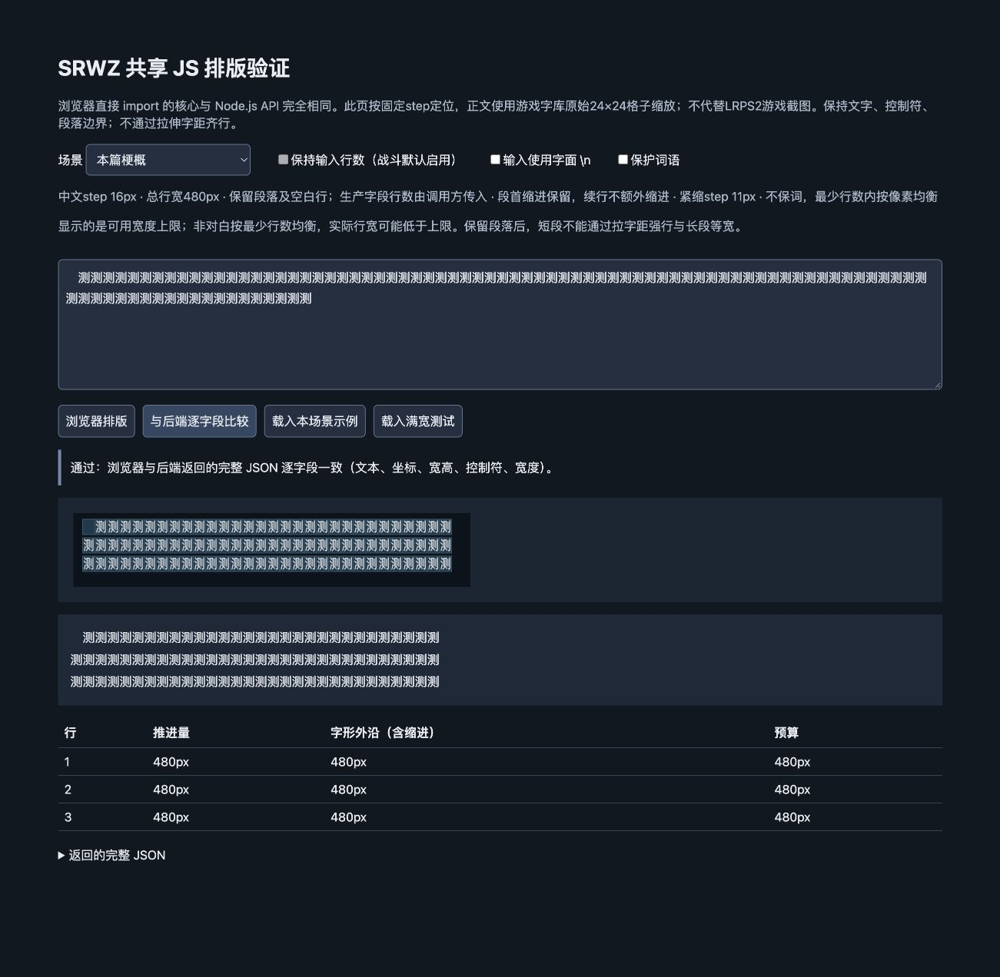
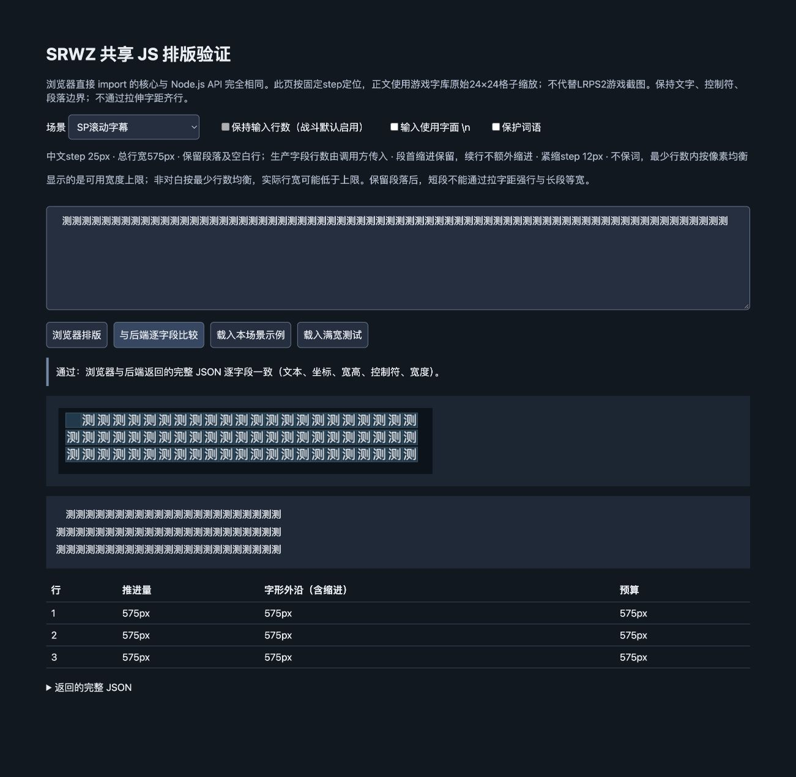
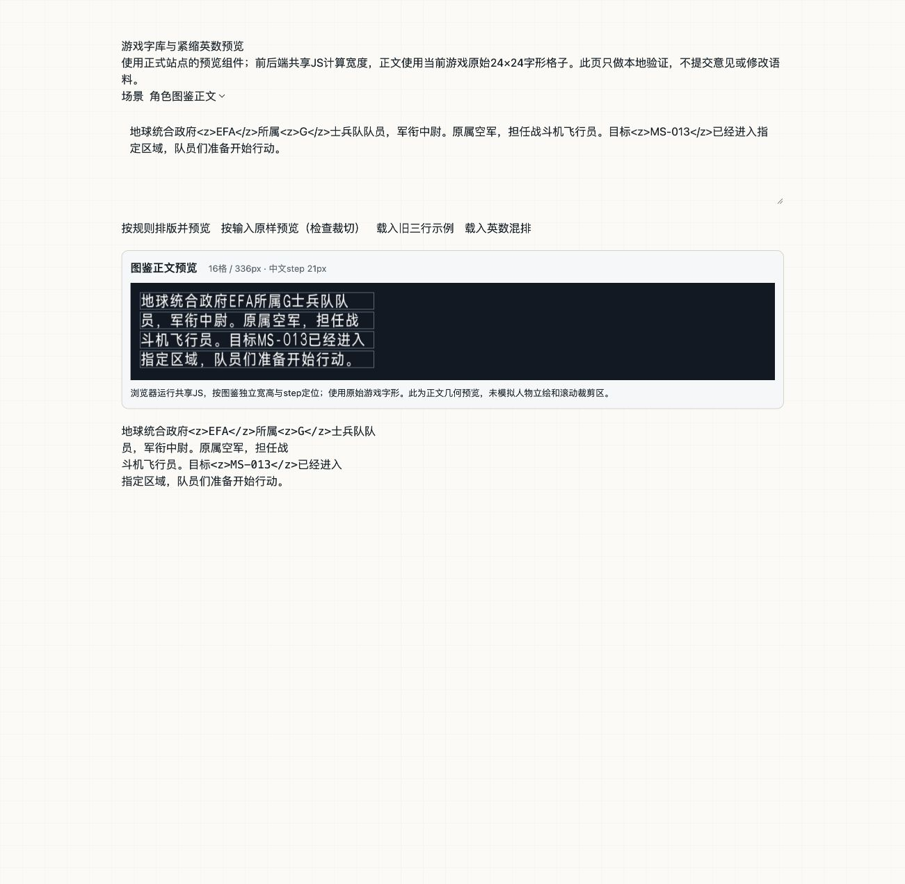

# 共享 JS 排版核心（2026-10-28）

目标：以相同场景契约、相同纯JS算法供浏览器本地排版和后端重算，避免前端用Unicode字数或CSS测量、后端用游戏step导致分行不一致。实现位于 [shared/text-layout](../shared/text-layout/README.md)。

## 已落地

- `engine.mjs`：无外部依赖的ES module；`layout`、`measure`、`validate`、`expandCompact`、结构化错误、逐字形坐标与宽高。
- `contracts.mjs`：从当前Python配置、词表、控制符协议、留存的原生场景参数生成；不是在JS手抄第二份数字。生成器 `export_js_contracts.py --check` 检查源文件SHA与内容漂移。
- 明确区分七种scene：剧情、战斗、本篇/SP梗概、本篇/SP滚动字幕，以及本篇窄条字幕。禁止根据一个step猜测所有字宽、字高、行数或缩进规则。
- 浏览器本地验证页与Node HTTP `/api/layout`，两边import同一文件、使用同一输入协议。
- JSON/JSONL CLI和 `tools/srwz/js_layout.py` 批量适配器，让Python资源工具可以直接调用JS，不必再移植一份算法。
- `engine.d.mts`：TypeScript调用声明。

## 规则与边界

所有行宽按推进量及字形右缘计算；引号、缩进计入总预算，闭引号无额外格。剧情21px/483px/最多3行；战斗22px/462px/最多2行。对白续行一全角空格。梗概16px/480px，本篇普通滚动24px/528px，SP滚动25px/575px；本篇两条窄条字幕单独24px/504px；散文保留段首、段落边界与原生空白行，调用方提供字段行数预算。

`<z>` 保持作者语义，按各场景编译完整宽/高/step进入与恢复。末字形外沿也检测。英数不擅自删除、改写或自动加标签。核心不自动补外层引号；源文驱动的引号规范仍属资源/审阅适配层。

对白采用`max_width`优先填前行并保留既有词表；梗概/滚动字幕默认`balanced_width`和`protectWords:false`，只保留标点禁则、完整控制符和紧缩标识符。战斗默认保留行数，批准改变后传 `preserveLineCount:false`，由资源owner记录字幕换行许可。作者输入的 `\n` 需显式开启 `escapedNewlines`，不与实际LF混淆。

动态图文模板、原生重复/方括号参数、未知控制符、对齐卡片、独立选项等不猜测排版，要求owner契约。关键词链接显式开启 `keywordLinks`，不能把一般书名号当不可见控制。

本地社区站的普通剧情/战斗重排与预览测量也已接入共享JS。源文引号、特殊owner和图鉴适配层仍保留，全部ISO构建调用未整体迁移；迁移仍需核对编码容量及源文绑定，不把样本通过当全语料迁移完成。本轮未自动改写语料、提交、推送、部署或重建ISO。

## 验证

- JS核心15项测试通过，包括读取已留存LRPS2混排字形记录，核对宽高、X坐标、换行样本、紧缩恢复和2px外沿。
- Python真实Node子进程适配器4项测试通过。
- 最初的767个差分请求曾有765个结果与旧Python一致、2个对齐owner明确拒绝；后续按用户最新散文规则更新，当前结果见末节，不再将新均衡输出等同旧收窄稿。测试采样本篇剧情/战斗、四类梗概与滚动文本，并覆盖全部六场景紧缩参数；不是全语料或所有特殊owner的等价证明。
- 初版六场景浏览器本地与Node HTTP返回的完整JSON均一致（后续新增窄条场景，当前七场景复查见记录）（文字、行宽、字形位置、宽高、控制符）。
- 当前宽度下，3000字加首行缩进的梗概压力用例为101行，本机执行约37ms；性能数字不是跨设备保证。
- 生成契约漂移检查、JS语法检查、Python编译检查及本轮路径的差异空白检查通过。

[Python差分记录](issue-assets/shared-js-layout-20261028/python-parity.json) · [浏览器七场景检查](issue-assets/shared-js-layout-20261028/browser-scenes.json) · [HTTP七场景检查](issue-assets/shared-js-layout-20261028/http-parity.json)

本地验证页：`http://127.0.0.1:8767/`。启动：`node shared/text-layout/server.mjs`。页面是固定step的几何示意，不是游戏光栅截图；原生显示依据仍是之前的LRPS2记录，本轮未新增游戏实机验收。

## 用户截图反馈后的社区站接入与窄版预览修复

旧站点预览曾将战斗3行拆成两个窗口，并按剧情参数展开战斗紧缩scope（结束恢复21/12），宽度也仍为480px。现已在本地修正：

- `tools/text-layout/format.py` 的战斗重排与普通剧情溢出重排调用共享JS，源文外层引号和特殊owner仍由原有适配层负责。
- `tools/text-layout/preview.py` 使用共享JS返回字形坐标；浏览器 `lib/review-preview-geometry.ts` import同一份ESM复算，剧情预算483、战斗462。
- `app/review-layout-preview.tsx` 正文改用游戏字库原始格子；战斗窗口单屏、可见高度102px（448-346），正文起点X160/Y46、行距24px。超过2行显示实际裁切并警示，不再分页掩盖。剧情X80/Y62、行距28px。
- 英数按W14/H11、step12；结束后的中文恢复剧情21/12/21、战斗22/11/22。图片格子本身保留24×24原始基线，不用网页字体的字符bbox重新对齐。名字仍用站点锁定字体，变量保留占位，字库缺字显式提示网页字体回退。
- 字形来自已核验Original发布ISO（其SHA见atlas元数据），解码字库SHA `200ad07d7953496154de6767d7deefd2543f16b8612aca0bc647c85fa351913c`。5507字符、4042原始格子；RGBA仅白色+4bpp灰度映射alpha，不重绘字形。
- `sync_text_layout.py` 把完全相同的JS字节分发到Node调用目录和前端lib目录，连同字形资产一起核验；`prepare_preview_assets.py` 增加PNG/hash与源文件一致性检查。Node进程路径显式传给Python适配器，避免服务PATH选择不同Node。

共享核心测试目前合计15项通过；站点原有格式化11项与新增原生预览4项共15项通过。应用类型检查通过；全仓类型检查仍被未改动的 `scripts/review-store.test.ts` 五处unknown类型错误阻挡，另用排除该已有测试文件的临时配置核对应用及本轮类型。767个差分请求再次通过。不是全语料/所有特殊owner整体迁移完成。

浏览器已验证旧3行原样会裁切，格式化后2行；另验证Gundam01、013、80%与恢复中文的显示。[窄版效果](issue-assets/shared-js-layout-20261028/browser-native-compact.png) · [第三行裁切提示](issue-assets/shared-js-layout-20261028/browser-native-third-row-clipped.png)。

本地站点页 `http://localhost:8768/layout-lab` 使用正式预览组件；共享纯JS页 `http://127.0.0.1:8767/` 同样改用原始字形格子。线上未部署、未重建ISO。

社区站本地目录无Git元数据，因此另将12个源码文件的修改保存为 [community-web.patch](issue-assets/shared-js-layout-20261028/community-web.patch)，并记录修改前后SHA；生成的JS副本/字形资产由 `npm run layout:sync` 同步，不在补丁中重复存储。实际本地文件已经修改，补丁仅作留存。

本地开发服务曾因监听巨大work导出快照耗尽内存；本轮仅为验证使用 `work/vite.native-layout.config.mjs` 排除work/dist/output/.wrangler监听，不改正式Vite配置。恢复后剧情、战斗原生字形均已在浏览器显示正常。[剧情窄版截图](issue-assets/shared-js-layout-20261028/browser-native-story-compact.png)。

## 最后确认的宽度与非对白策略纠正

此前JS误从另一份收窄作者配置取出400/504/525，用户指出与最后游戏验证不符。现以最后一次v8全量记录和写入预览报告为依据，新增 `config/text-layout/native-scene-contracts.json`，绑定 [宽度证据](issue-assets/shared-js-layout-20261028/prose-width-evidence.json)。梗概30格/480px；普通本篇滚动22格/528px；SP滚动23格/575px。两条504px窄条字幕 `summary/03/000`、`summary/04/000` 独立为 `main_scroll_strip`，可按resourceId自动选择。旧作者配置留作旧Python管线兼容，不能再用于新JS默认宽度；本轮未批量重排或写回语料。

用户最新要求非对白不考虑断词、各行尽量同宽：四类梗概/滚动及窄条默认取消中文词、人名、数字单位保护。保留完整控制符与闭合紧缩scope、标点禁则、段首和空白分隔。在最少可行行数内，以包含首行缩进和字形外沿的像素宽度做均衡，目标为对该段平均推进量的平方偏差最小；并列优先前行较宽。不同段落的不可消除差异保留，不补字距或缩放对齐。剧情/战斗保持原来的保词和max_width策略。此最新策略取代本轮先前对散文采用max_width的默认，不追溯声称旧LRPS2截图使用了新均衡算法。

JS回归现15项通过，其中850组纯中文长度/缩进检查最少行数及行宽差<=1step；Python适配器4项通过。差分767请求全通过检查：689个结果仍与旧Python相同，2个对齐owner按约定拒绝，91个散文新策略请求中76个输出有意改变并核对了原文、行宽和有效性。不是767个输出与旧配置完全相同，也不是新均衡语料的LRPS2全量验收。

浏览器七场景与后端完整JSON复查均通过。另用满宽标尺验证本篇/SP梗概480px三行、本篇普通滚动528px三行、SP滚动575px三行、窄条504px三行；这些是诊断文本，不是新的游戏截图。

## 图鉴正文与浏览器按钮接入补充

先前图鉴仍调用Python，不能称为已移植。现新增三类图鉴正文scene，当前总计十场景。角色16格/336px，机体26格/546px，术语25格/525px，全部step21；机体中文H10，其余H12，英数紧缩与恢复单独处理。字段DSCR/DSC2格式化改调共享JS，显式preserveLayout仍保留原样，名称/作品/声优/参数字段继续由各自owner处理。新正文排版按用户最新非对白规则取消保词、在最少行数内均衡；不是复刻旧Python保词稿。

浏览器格式化按钮对接口返回的已绑定输入执行相同layout，再核对后端结果后写入编辑框；后端保留原文绑定、外层引号及特殊owner处理。图鉴正文新增原始字库预览组件，浏览器measure复算；不是原生立绘及滚动裁剪模拟。角色/机体/术语三场景均经浏览器和Node完整JSON比较通过，记录见library-browser-parity.json。应用范围类型检查通过；JS核心16项、站点相关16项、Python适配4项、原有767请求检查通过。本轮未部署、未全量重排图鉴语料或重建ISO。

## 审阅站上线与构建门禁

2026-10-28已部署 `shared-js-layout-20261028` 至 https://srwz.dreamquest.club ，运行包对应共享JS SHA见deployment-receipt.json。保留线上2a011381发布的326个数据文件，新增battle-preview-portraits.json；审阅数据库保留并在切换前在线备份。未部署本地layout-lab诊断路由。

`npm run build`新增layout:test，先执行十场景及五类资源适配器真实Node/Python检查和相关浏览器几何测试，再构建；prepare_standalone对复制后的独立包再次检查；部署服务器切换release之前再执行该门禁。字体图集metadata和hash命名PNG纳入缓存刷新及预热清单。本次三条缓存URL均为新增，无既有缓存URL变更；阿里云API connector不可用，但17个新增程序/字库资源已通过公共域名GET验证。

线上真实UI完成剧情三行（21px step）、战斗两行（22px step、21格总宽）格式化预览，输入MS-013、GN、80%验证紧缩，续行一全角缩进。测试建议未保存。截图live-story-preview.png与live-battle-preview.png为正式网站截图，不是本地示意，也不代表LRPS2实机证据。

网站全套review:test为83通过、1失败：SP专题已发布数据与本地最新battle-lines语料换行不一致。为保持程序发布范围未重导出该数据；本轮格式化/几何16项、部署9项、打包后及远程运行门禁均通过。此次接入审阅站build/运行包/部署；游戏ISO构建器未整体切换，未重建ISO。

## 剧情黑字修正与游戏构建接入（本轮最终状态）

用户指出剧情正文应为黑字。白色RGBA字库图集的RGB不受SVG fill影响，旧深色fill因此未能染色。现以仅作用于剧情正文图片字形的brightness(0)保留原alpha并转黑；剧情姓名仍蓝色，战斗与图鉴白字保持。SVG容器宽度选择器收窄为直接子元素，不再影响内部字形viewport。已在正式网站截图确认live-story-black-preview.png。最终发布为shared-js-final-20261028；服务器独立运行门禁含旧Python战斗重排入口调用，已确认其转入同一JS。门禁曾拦住检查脚本将字符串路径传给Path接口的错误，候选包未切换；修正后复验并完成发布。

游戏侧新增tools/srwz/build_layout.py：Original/Best/SP总入口先运行十场景JS检查；shared/text-layout四个运行文件纳入冻结输入、组件指纹和报告输入SHA。独立临时目录测试证明冻结后的Node/Python入口不依赖原工作目录。纯预览素材不进入游戏组件指纹。

- 图鉴CHAR/ROBO/KYWD正文按原生336/546/525px调用JS批处理。生产容量回退入口不再切回另一套Python断行；自定义旧工具预算仍保留其显式旧适配。字体编译、字段编码、二进制容量和回读继续归资源owner。
- 本篇剧情构建逐关批量用JS校验既存文本，不静默重排；剧情作者工具与SP普通对白fit接入共享JS。源结构对齐卡片、独立选项、固定字格等特殊owner仍保留独立格式处理。
- 本篇及SP战斗构建使用JS核对既存宽度和两行上限；原有原文、索引与字幕时序许可继续检查。reflow_battle_subtitle兼容入口已转JS，保留preserve_line_count语义。
- 梗概及滚动作者工具、SP梗概与滚动writer接JS；本篇存储字段增加JS几何门禁。作者默认统一为梗概30格、本篇普通滚动22格、SP滚动23格，窄条504px按resourceId。同步了梗概policy宽度元数据及对应输入锁，没有改写正文。

真实输入审计：本篇剧情83668条、本篇战斗25708条、SP战斗123条、生产字形编译后的图鉴正文1226组全部通过。梗概/滚动169条生成写入前计划通过，其中154条提出新断行；计划未应用，未重建ISO，也未声称新ISO容量/回读或LRPS2验收。现有游戏几何与本轮网站截图证据分开留存。

测试：构建桥8项、布局相关74项、段落19项、SP梗概11项、三版编排33项、增量缓存10项、场景8项、剧情12项、JS适配4项、JS核心16项和767请求检查通过。网站黑字及几何6项、十场景/五owner独立运行门禁通过。该数列为分别运行的检查，部分有覆盖重叠，不加总为独立测试总数。全站此前SP专题快照与最新本地battle语料换行差异仍保留，不扩大发布数据范围。
