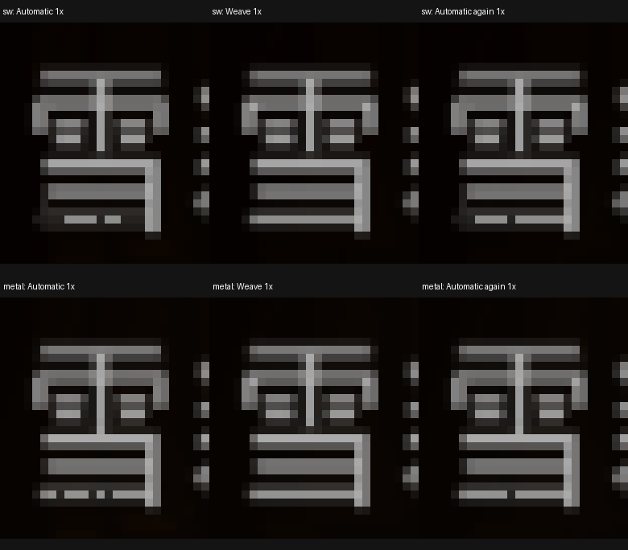
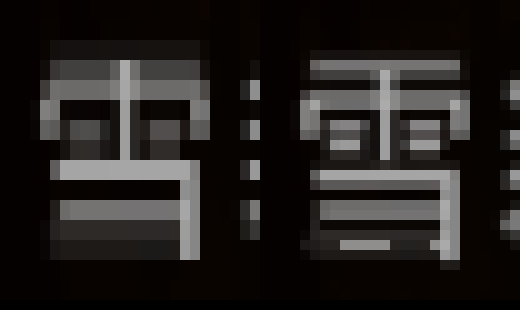

# 图鉴“雪”字底横断笔根因（2026-11-06）

本次 SP 莉露图鉴的直接原因已定位为 **原生 1× 输出的自适应去交错（FastMAD）重建**。不是字库缺笔，也没有证据支持在正文中增加字号或位移控制符修复它。

## 受控运行证据

使用冻结的 SP ISO：`build/iso/font-sampling-fix-20261106/base.iso`，SHA-256 `e5d7e3733ba5962e8f65155438ee10ccda14f3a8051a493ff9485ff6f9bdd582`。从真实存档冷启动、自然进入莉露图鉴，不注入文字。SW 和 Metal 分别运行，全部 upscale=1，输出均为 640×448。

同一会话按 `Automatic → Off → Weave → Blend → Adaptive → Automatic` 切换；每次推进 120 帧后捕获两个相邻帧及 GS 显存。只改变会话内 GS 去交错选项，ISO、字库、原生绘制尺寸、坐标、控制符完全不变。切回 Automatic 可以再次复现断口，排除刚切换时历史缓存未稳定的单帧现象。

- Automatic：底横出现断续亮块，SW、Metal 均复现。
- Weave：底横连续，SW、Metal 均复现。
- 切回 Automatic：断口再次出现，具体缺口可随帧变化。
- Off：不重建隔行，显示为单场拉伸，形态不同；它只作诊断，不作为修复。
- Blend：底横连续但整体变软，同样不是正式修复。



上图放大的是已生成的原生 1× 截图，未提高模拟器内部渲染分辨率。完整画面：[full-page.png](issue-assets/snow-stroke-root-cause-20261106/full-page.png)。机器可读记录：[verification.json](issue-assets/snow-stroke-root-cause-20261106/verification.json)。

## 缺口如何产生

此前逐级核对已经证明源 24×24 字格、RAM 字形图集与 GS PSMT4HL 图集的 576 个纹素完全一致，底横存在。进一步按 PSMCT32 地址还原 GS 帧缓冲，底横同样连续；断口出现在后续显示重建后。



FastMAD 不是整行统一处理。它逐像素比较历史场和相邻行，部分位置保留另一场的像素（weave），部分位置用上下行均值替代。细横画本来就与上下行亮度差很大，一旦采用替代，笔画亮度大幅下降，同一横画因而出现断口。

实际 SW Automatic 样本中，底横输出行 y=268、x=14..25 的红通道为：

```text
37 37 143 143 143 143 37 142 142 38 38 38
```

这些暗段的上下行对应值约为 45 和 29，均值恰为 37；Weave 对照同一底横为连续的 142..143。Metal 对照同样从约 146..147 的笔画被局部替换成 38..39。也就是说，缺口不是未知字符或字号切换，而是笔画像素被重建成了邻行平均值。

代码链路（`../armsx2-runner`）：

1. `pcsx2/GS/Renderers/Common/GSInterlaceModePolicy.h`：Automatic 的场输出在原生 1× 选择 shader mode 3。
2. `pcsx2/GS/Renderers/Common/GSDevice.cpp`，`GSDevice::Interlace` case 3：先存历史场，再执行 `MAD_RECONSTRUCT`。
3. `pcsx2/GS/Renderers/Metal/interlace.metal`，`ps_interlace4`：高运动或低运动下的局部空间判断均可能返回 `(hn + ln) / 2.0f`，否则保留 `cn`。
4. 整数高倍场渲染可能满足 `field_render_is_whole_picture`，策略直接呈现场画面，跳过去交错。因此 4× 正常既涉及采样分辨率，也涉及输出路径变化，不能简单认定是提高分辨率补回了源字库缺笔。

本次证据确定到 **FastMAD 这条路径是断口的必要触发条件，Weave 对照消除断口**。未逐片元导出 shader 的历史场输入，尚未区分每个断点具体命中了“高运动”还是“低运动空间判断”的分支；动态背景、半透明抗锯齿等对该分支判断的各自贡献尚未单独量化。

## 本轮改动与边界

- runner 仅增加 `interlace 0..9` 会话诊断命令，并已重新编译运行验证；不会写入用户配置。
- UV 相位/跨度试验只存在独立候选 ISO 中，没有写入当前发布 ISO。它们能移动或减轻断口，但会改变其他笔画，不作为根因修复。
- 未修改正式字库、原生绘制代码或字体控制符；未提交或 push。
- 本结论针对当前 ARMSX2 SP 莉露图鉴，不能直接当作其他模拟器、全部游戏画面或实机的验证结果。

下一步修复应针对显示重建对静态细横画的保留策略，并同时回归移动画面的梳齿和闪烁。直接全局强制 Weave 可能损害运动画面，不能凭这一张静态图作为全局默认值上线。若另行采用字体加粗或预滤波，它属于提高下采样稳健性的取舍，需要独立验证，不应掩盖本次已经定位的重建问题。
