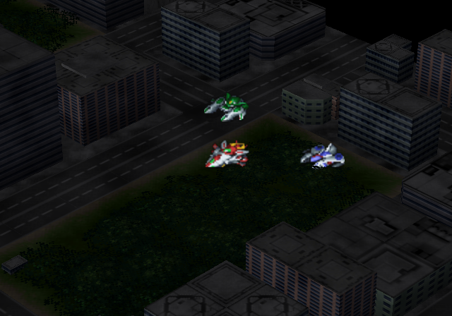
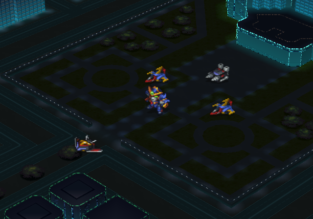
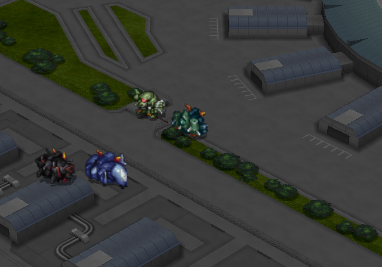
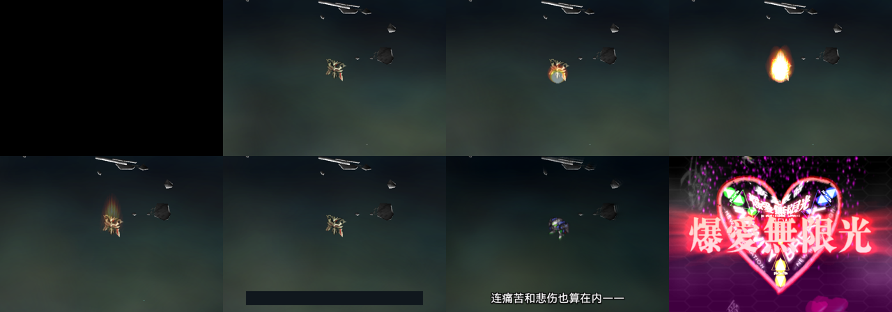
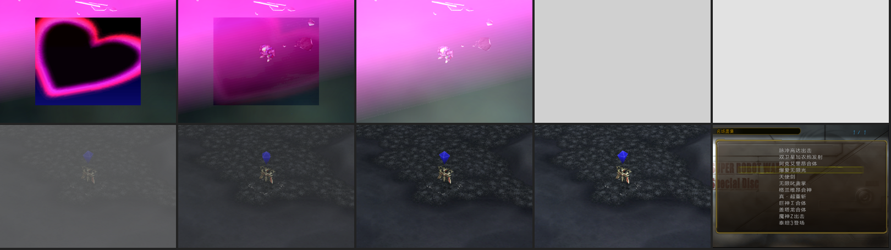
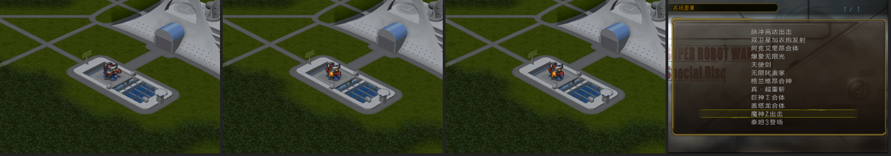
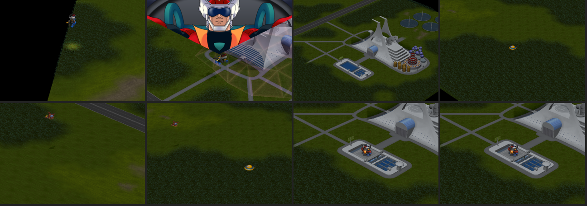

# SP特别剧场事件演出：本篇机体、镜头与BGM对齐（2026-10-14）

接手[交接文档](CLAUDE_HANDOFF_SP_EVENT_FIDELITY_20261013.md)。目标是让12段鉴赏在所选片段内呈现原关卡脚本里的必要机体、舞台动作、镜头状态和BGM；不复制整关剧情、对白和战斗。运行验证只用LRPS2。

## 候选与结论

- 验收候选：`work/iso/archive/sp-event-gallery-fidelity-review.iso`（原路径 `work/iso/`，验收后归档；精确哈希见[来源记录](issue-assets/sp-event-fidelity-20261014/provenance.json)）。同日稍后鉴赏并入统一构建，`build/iso/special-disc/sp-current.iso` 直接包含鉴赏，三个鉴赏成员与该候选逐字节相同，见[构建整合记录](SP_EVENT_GALLERY_BUILD_INTEGRATION_20261014.md)。V7 移至 `work/iso/archive/sp-event-gallery-subtitles-v7.iso`。
- 构建源仍是 `sp-current.iso`；字幕、标题、列表入口与V7相同，未改台词。
- 12段场景脚本改为由配置里的逐段“原脚本移植时间线”生成，每条操作都写明Original STAGE偏移；SP中的机体/驾驶员编号按定义映射，不直接复制Original数字。

- 候选ISO SHA-256：`c163bac907102785ced658f8569c791f06dee23e2e277d775949ba25d46fb7be`；ELF SHA-256：`ed648f6596045b9fcd3d893f766efc8d457b13b691b02b95a8d3041abd711340`。
- LRPS2（Software）冷启动、隔离记忆卡、原生按键：12项各播放一次，再重复魔神Z、脉冲、鸫三项，共15轮，全部自然结束并返回原列表、保留选中项；无宿主写入、即时存档或函数调用干预。见[流程报告](issue-assets/sp-event-fidelity-20261014/runtime/flow-report.json)、[逐段状态](issue-assets/sp-event-fidelity-20261014/runtime/scene-report.json)、[完整命令记录](issue-assets/sp-event-fidelity-20261014/runtime/commands.jsonl)。
- 15轮中每段播放时运行中的BGM曲号与原脚本/资源头曲号完全一致，剧场的99号曲不再混入；视角方向与原脚本一致；每次返回后 `0x5a5080～0x61b9c0` 名册快照逐字节相同，关卡标志、缩放、占位单位表与回调均与列表状态相同，BGM回到99号并处于播放状态。
- 静态测试：`tests.test_sp_event_gallery_fidelity`（新增6项）与原有记录/贴图测试共10项通过。

## 反编译结论

SP解释器 `FUN_001785b0`（扩展指令 `FUN_001c2e30`）与Original同构。本轮逐条核实了片段内用到的指令，纠正了此前的几处误读：

| 指令 | 实际功能（SP地址） | 说明 |
| --- | --- | --- |
| `0x43 a` | 载入并播放BGM `a`：`FUN_00182fc0(a,b,c,1,3,0)`，当前曲号存 `0x5dbb98` | `a=-2` 播关卡默认曲（`0x4a` 设置）；`a=-1` 是“开始已暂停载入的曲子”，不是停曲 |
| effect资源头 | `+6/+7` 落点格子（`0xff`为不覆盖），`+8` BGM曲号，`+10` 载入后延迟帧数（`FUN_001ad000`/Original `FUN_001a9270`） | 256/264/266/267四段的BGM由资源头自己播放 |
| `0x41 n` | 地图视角旋转到方向 `n`（`0x61bdd0` 是相机偏航 `0x61bddc` 的象限），带动画，完成后才继续 | 不是“剧情阶段” |
| `0x1c 3` | 隐藏战术光标（`FUN_00176030`） | 第五版文档把魔神Z的 `0x9f40 0x1c 3` 当成“镜头方向3”，属误读；方向3实为所有关卡地图初始化的默认值 |
| `0x29 z` / `0x13b9 z` | 相机缩放 `DAT_00457748`：前者带动画并等待，后者立即设置 | 剧场列表时该值为 −36，本篇地图默认 −11 |
| `0x13bc` | 关卡内切换地图（地图号、相机格子、方向） | 双卫星加农炮在 STAGE126 切到地图3、视角1，再 `0x41 0` 转到视角0 |
| `0x18 k,…` | 相机移到单位（k=1/2）或格子（k=6） | |
| `0x1388 v → 0x910e
` | 显示/隐藏携带驾驶员 `p` 的地图单位；`0x910ef0<s>` 按阵营 | |
| `0x13ae` | 撤下地图单位 | |
| `0x13bf 1,u` | 格兰维昂合神登记（`FUN_001c2ba0`，组合表 `0x475450`） | |
| `0x1395 a,b,c` | **占位地图单位表**：按 `b>>16` 取表项，`b&0xffff` 为模式（1出现特效、3爆炸、0无），`c>>16` 设/清该项的关卡标志；标志决定占位单位是否绘制 | 表由关卡初始化经 Original `FUN_001bdb20` / SP `FUN_001c0f70` 安装；真·超重斩 `0x15710` 之后的系列即斩击扫过26个泽拉拜亚占位单位，逐列爆炸并清除 |
| `0x13b0` | 画面叠色（`0x2da0/0x2da8`），配合 `0x138d/0x1390` 循环做渐暗 | |
| `0x4b` | `FUN_001834b0` 音效类请求 | 片段内未使用 |

BGM编号：两盘 `BGM/BGM.BIN` 逐字节相同，曲号重映射表（Original `0x411b20` / SP `0x46ccb0`，恒等映射）与流偏移表（`0x411b88` / `0x46cd18`）逐字节相同，音乐鉴赏表102项曲名一致。因此Original曲号在SP播放同一首曲子，见[BGM同一性](issue-assets/sp-event-fidelity-20261014/bgm-identity.json)。

机体/驾驶员编号：按两盘COMPDATA定义表对照（Original单位表 `0x4CAE4`、驾驶员表 `0x2160`；SP单位表 `0x54b90`、驾驶员表 `0x2b50`），同名组内按序号对应并以记录字节相似度核对，见[编号映射](issue-assets/sp-event-fidelity-20261014/id-map.json)。例：Garrod 320→330、Apollo 602→623、格兰凯撒601→645、高性能AI 908→949。

## 运行时实现

- 场景开始先显式设置缩放、视角和BGM。列表处剧场残留缩放−36不再带入地图；返回时恢复。
- 机体：`gallery_prepare_units` 先找SP剧场名册中已有模板，没有时用原生定义加载函数在空位初始化（单位 `FUN_00149710`、驾驶员 `FUN_001492c0`），再按魔神Z已验证的方式启用、原生绑定，并调用 `FUN_00174a80` 建立地图精灵缓存；随后由原生出场表 `0x0d` 生成。不依赖剧场存档里恰好有该机体。
- 恢复：沿用 `0x5a5080～0x61b9c0` 485696字节快照，新增关卡标志 `0x5dbc40`、缩放、占位单位表/槽位、绘制回调和地图精灵缓存 `0x61bfc0` 的快照；返回时关闭叠色、按原生接口卸回占位表。剧场BGM（列表时为99号 BREAK TIME）在场景声音请求空闲后用原生接口重新播放。
- 场景脚本移到字幕表之后（`0x826800`），构建时检查 `0x825800～0x826800` 字幕表区未被占用。

## 12项对齐清单

| # | 标题 | 原脚本窗口 | BGM（运行时一致） | 视角/缩放/镜头 | 机体与舞台动作 | 未纳入或取舍 | 画面 |
| --- | --- | --- | --- | --- | --- | --- | --- |
| 0 | 脉冲高达出击 | STAGE002 `0xa370～0xaa90` | 0x45 ＳＴＡＧＥ・Ｄ（段落开头）→ 0x1e ＩＧＮＩＴＥＤ（`0xa790`） | 视角3；缩放−11；镜头奥尔→史汀格 | 史汀格/混沌、奥尔/深渊、史黛拉/盖亚（阵营4）与阿雷克斯/扎古勇士（阵营12）在场。**前奏（10-15 补）**：镜头奥尔，扎古 (12,13) 周围 effect 15×3、effect 1×3、effect 8，再在扎古上 effect 33（`0xa4c0～0xa770`，深渊攻击亚历克斯）；然后换曲、镜头史汀格、273；273期间按原脚本隐藏阵营0/12/4，1310帧后恢复舞台模型与单位；间隔120帧；274开始隐史汀格，40帧隐阿雷克斯，再按原帧显示。 | 奥尔(13,15)、史黛拉(13,16)为脚本坐标；阿雷克斯用部署格(12,13)，史汀格放在其东侧(13,13)。扎夫特杂兵到场不在片段内。 | [帧](issue-assets/sp-event-fidelity-20261014/review-20261015/row0-montage.png) |
| 1 | 双卫星加农炮发射 | STAGE126 `0xb680～0xbc30` | 0x19 サテライト・キャノン（`0xb770`） | 地图3视角1起，`0x41 0` 转到视角0（`0xb820`）；缩放−11；切回地图57后缩放−16 | **（10-15 补）**切白后出场表 `0x8840`：加洛德的 DX (20,23) 朝向3（动画出现），从0xf8渐亮，视角转0，镜头加洛德，255开始时隐藏；650帧后渐暗、切白；结束后撤下 DX，**`0x13bc` 切回地图57**（镜头 (3,16) 视角3，缩放−16，物件归零、1～4隐藏），渐亮，**effect 251 落点 (17,17)**，物件4播放到499帧，再渐暗返回。 | G猎鹰小队成员与队长共用贴图，不单放；兰斯洛随玩家，不放。 | [帧](issue-assets/sp-event-fidelity-20261014/review-20261015/row1-montage.png) |
| 2 | 阿克艾里昂合体 | STAGE021 `0x8680～0x8910` | 资源头0x2e 創聖のアクエリオン | 视角3；缩放−11；镜头 (10,11)→(11,4) | **（10-15 补）**镜头 (10,11)、effect 20 在 (11,10)（绿色光球）、60帧，再镜头 (11,4)；矢量太阳/火星/月神在(11,4)(12,3)(10,3)，特效开始即撤下；1538帧太阳阿克艾里昂/阿波罗于(11,16)原生出场。 | 脚本在 `0x8670` 提前放曲，鉴赏不能提前（资源头会重放），前奏在暂停的剧场曲下播放；原脚本在特效结束前2帧出场后进入对白，鉴赏多停60帧。 | [帧](issue-assets/sp-event-fidelity-20261014/review-20261015/row2-montage.png) |
| 3 | 爆爱无限光 | STAGE117 `0x12b80～0x12d10` | 0x2f Ｇｏ　Ｔｉｇｈｔ！（`0x12b80`） | 视角3；缩放−11；锚点(13,7) | 810帧后渐暗到0xfc；保留257反馈保护与字幕。 | 鸫的单位整段隐藏，原锚点随玩家移动，保留既有(13,7)。 | [帧](issue-assets/sp-event-fidelity-20261014/runtime/row3-0452.png) |
| 4 | 天使剑 | STAGE128 `0x10620～0x10a60` | 0x2f Ｇｏ　Ｔｉｇｈｔ！（渐亮后） | 视角3；缩放−11；镜头皮耶尔 (13,5)→(13,6)，落点(13,5) | **（10-15 补）**皮耶尔的アクエリオンエンジェル (13,5) 朝向1、诗翅的ケルビムマーズ (14,7) 朝向3（阵营12）；从0xfc每帧−2渐亮，换曲，镜头 (13,6)，258开始时隐藏两机；1270帧压暗0xfc；结束后显示两机、再渐亮、停60帧、淡出。 | 两机位置随玩家，取落点锚点；特效自己绘制天使与目标的贴图，所以原脚本先隐藏实际单位。 | [帧](issue-assets/sp-event-fidelity-20261014/review-20261015/row4-montage.png) |
| 5 | 无限叱咤掌 | STAGE107 `0x141c0～0x145f0` | 0x2f Ｇｏ　Ｔｉｇｈｔ！ | 视角2（`0x141d0`）；缩放−11；镜头阿波罗 (6,26)→(8,26) | **（10-15 补）**阿波罗的ソーラーアクエリオン (6,26) 朝向2、双翅的ケルビム兵 (10,26) 朝向0（阵营12，坐标来自对白框 `0x142b0/0x142c0`）；259开始时隐藏两机；640帧撤下双翅并出场光球；结束后显示阿波罗、停90帧、淡出。 | 布雷克路线分支（布雷克代替阿波罗）未做。 | [帧](issue-assets/sp-event-fidelity-20261014/review-20261015/row5-montage.png) |
| 6 | 格兰维昂合神 | STAGE007 `0x9170～0x94e0` | 资源头0x29 合神！ゴッドグラヴィオン | 视角3；缩放−11；镜头(11,6) | G攻击者/突击者/钻地者/影子（AI，阵营1）位于(10,5)(12,5)(11,4)(11,8)，格兰凯撒/斗牙在(11,6)，**鸫的单位 (6,8)（10-15 补，`0x9280` 对白框）**；+1帧隐藏斗牙，1415帧撤下四机、显示斗牙并执行原生合神登记 `0x13bf`。 | 其他小队与泽拉拜亚组未被片段引用，不放。 | [帧](issue-assets/sp-event-fidelity-20261014/review-20261015/row6-montage.png) |
| 7 | 真·超重斩 | STAGE107 `0x15620～0x15c60` | 0x28 嘆きのロザリオ（`0x15620`）→ 0x2a 紅ノ牙（`0x15be0`，揭示后） | 视角3；缩放−11；镜头(18,3)，揭示时 (18,4) | 安装STAGE107占位表，26个泽拉拜亚占位单位按标志30～54显示；**（10-15 补）**斗牙的ゴッドグラヴィオン (18,4) 朝向0、布雷克的ソル═グラヴィオン (20,2) 朝向2（阵营12）在场，特效开始时隐藏；特效前渐暗到0x80，开始10帧后解除；1270帧后按原序列逐列爆炸并清除；**结束后镜头斗牙、显示两机、停180帧、换曲紅ノ牙、渐暗到0xf8返回**。 | 两机位置随玩家，取镜头附近锚点。 | [帧](issue-assets/sp-event-fidelity-20261014/review-20261015/row7-montage.png) |
| 8 | 巨神Σ合体 | STAGE026 `0xa320～0xa6e0` | 资源头0x06 がんばれ！宇宙の戦士 | 视角3；缩放−19（`0xa340`）；镜头(18,18) | **（10-15 补）**空雷王/闘志也 (16,17)、海鳴王/ジュリィ (17,18)、陸震王/キラケン (18,17)（对白框 `0xa3c0～0xa3f0`，(17,17) 在地图45上不可停留）；舞台模型1第800帧；2699帧撤下三机、神Σ/闘志也于(17,19)原生出场；光标隐藏。 | `0x13c1` 副驾驶连结与 `0x13b4` 编队未移植。 | [帧](issue-assets/sp-event-fidelity-20261014/review-20261015/row8-montage.png) |
| 9 | 盖塔龙合体 | STAGE043 `0xb790～0xb9c0` | 资源头0x05 われらのゲッターロボ | 视角3；缩放−18（`0xb810`）；镜头甲儿 (12,23)→(25,30) | **（10-15 补，按路线放我方机体）**甲儿的魔神Z (12,23)、铁也的大魔神 (16,23)；开头镜头甲儿、朝向2（`0xb7b0～0xb7d0`），再切到 (25,30)；阵营0/12隐藏；模型0显隐；501帧后恢复阵营显示并由盖塔龙/龙马在(14,23)原生出场。 | 原脚本只引用甲儿；大魔神为鉴赏选择；`0x13b8` 的40帧镜头滑动用直接切镜代替。 | [帧](issue-assets/sp-event-fidelity-20261014/review-20261015/row9-montage.png) |
| 10 | 魔神Z出击 | STAGE047 `0xadd0～0xb010`（光子力防护罩，effect 268）＋ `0x9f00～0xa320`（出击，effect 269） | 0x01 おれはグレートマジンガー（防护罩 `0xaf10`）→ 0x46 ＢＬＡＣＫ　ＡＬＡＲＭ（出击事件开头）→ 0x00 マジンガーＺ（出击后 `0xa260`，见下文） | 视角3；缩放−8（`0x9f50`）；镜头(19,25) | 保留V6的1600帧继承姿态、1724/2160/3240/3399动作和(32,13)原生出场，改用通用准备函数。 | 下一次换曲（`0xa260` 魔神Z主题）在片段之后。 | [帧](issue-assets/sp-event-fidelity-20261014/runtime/row10-1880.png) |
| 11 | 泰坦3登场 | STAGE069 `0x12cb0～0x12f70` | 0x0f カムヒア！ダイターン３（`0x12e80`） | 视角3；缩放−11；镜头万丈(18,17) | 泰坦3/万丈（原 `0x1d` 形态切换后的形态）在(18,17)、奥尔森的奈基克在(18,19)、**芙的加布兰 (18,15) 朝向2（10-15 补，出场表 `0xec50` 的路线分支）**，整段可见。 | 出场表的 (32,17)/(32,15) 是入场起点，`0x13b5` 走位到对白框给出的终点，鉴赏直接放终点；敌方增援未被片段引用。 | [帧](issue-assets/sp-event-fidelity-20261014/review-20261015/row11-montage.png) |

原脚本窗口的逐条反汇编见[原脚本](issue-assets/sp-event-fidelity-20261014/original-windows/)；每段配置里的时间线逐条注明来源偏移。每段播放录音（约12秒，从播放第90帧起）见 `issue-assets/sp-event-fidelity-20261014/runtime/audio-run*.wav`。

## 尚未还原、无法确定的部分

- 原关卡里随玩家操作而变的位置无法唯一还原：脉冲出击时史汀格贴近阿雷克斯的格子、鸫的爆爱无限光锚点。前者采用阿雷克斯部署格(12,13)及其东侧格，后者保留既有(13,7)；均在配置中注明。
- 片段内未被脚本引用、或存活取决于战斗进程的其他敌我单位（扎夫特杂兵、增援组、玩家其他小队）未搬入。
- 由出场表生成的单位只带主驾驶员；原脚本 `0x13c1/0x13b4/0x13b5/0x13c0` 的编队登记未移植，不影响地图显示。
- 出场表的高度字节0会把单位放到水下层（−0.125并置0x4000），陆上不绘制；原部署组的“高度0”无法用出场表等价表达，统一用原生默认层1。
- 芙的加布兰是否在泰坦3场景出现取决于存档全局标志 `0x1a0`，本版不放。
- 阿克艾里昂原脚本在1540帧特效结束前2帧生成单位后进入对白；鉴赏在特效结束后多停60帧以显示原生单位交接，这是鉴赏选择，已在配置注明。
- 资源头带BGM的四段（256/264/266/267）原本在对白中已开始播放同曲；鉴赏片段从特效开始，曲子随特效从头开始，开场先暂停剧场曲。
- 无法取得Original本篇对应画面的同机对照录像（第二关由用户手打验证），画面一致性依据是原脚本与SP原生执行结果；BGM依据曲号与运行时声音状态，并保留每段录音供试听。

## 后续修正（2026-10-14 晚）

用户在 PCSX2 上验收：BGM 与机体布置通过，真·超重斩（第 7 项，effect 265）结尾的泽拉拜亚占位单位爆炸
处出现黄绿色无贴图方块。LRPS2 软件渲染同样复现（`row7-1520`～`1595`）。

原因：`0x1395` 模式 3 的爆炸经 `FUN_001acb10` 启动**常驻地图特效** 1（出现／爆炸等 VEFF 块 1～19），
其资源表 `0x62a860` 在剧场里仍指向开机时加载的块（计数 19、指针有效），但贴图只在关卡初始化
`FUN_001ac220(1)` 时上传到显存 0x2d2a／0x2e2a（从 VEFF 块 0 读取后即释放），剧场与菜单早已覆盖，
鉴赏从未重新上传，于是爆炸只剩无贴图的四边形。

修正（`runtime.S`）：每个场景开始、清空特效池之后调用原生加载器 `FUN_001ac220(1)`——它重新读取
VEFF 块 0 上传贴图，并在堆上重新分配常驻块（约 425 KB）；为不泄漏，场景结束时在特效清空之后用
原生 `FUN_001a1718` 释放该块，再由快照恢复 `0x62a830～0x62aa60`（计数、表项、块指针）回剧场原值。
LRPS2 验证：三次连播块地址均为 `0x12b6bb0`、返回后为剧场的 `0xc18270`；名册与状态区域逐字节相同；
场景 6、7 爆炸正常贴图（见 `issue-assets/sp-event-fidelity-20261014/runtime-resident/`）。

同批字幕修改（用户指示）：巨神Σ合体"充能！"→"三位一体充能！"；盖塔龙合体"变形，盖塔龙！启动！"→
"变形，盖塔龙！Switch On!"。

未决：用户报告 PCSX2 硬件渲染下字幕笔画出现空心／阶梯（V7 无此现象）；贴图与绘制例程与 V7 逐字节相同，
LRPS2 截图一致，已提供只把缩放改回 −36 的单变量镜像 `work/iso/sp-zoom36-test.iso` 待对比。

## 爆爱无限光（第 3 项，effect 257）逐条核对（2026-10-15）

原脚本 STAGE117 `0x12b80～0x12d10`（调用点 `0x12c80`）与鉴赏时间线逐条对照：

| 原脚本 | 语义（反编译） | 鉴赏 |
| --- | --- | --- |
| `0x12b80 0x43 0x2f` | BGM Ｇｏ　Ｔｉｇｈｔ！ | `bgm 47` ✓ |
| `0x12b90 0xf 0x15` | 战斗对白 | 不适用（鉴赏无对白） |
| `0x12ba0～0x12bf0` IF 鸫可见：`139d/139e/139f/0x16` | 对白用立绘/气泡设置（整个关卡每段对白前都有同组） | 不适用 |
| `0x12c00 0x18 2,P616` | 镜头对准鸫的单位（位置随玩家行动而变） | 地图初始化镜头 (13,7)，文档锚点 ✓ |
| `0x12c10 0x139b P616, effect 21` + `0x139c` | 对鸫的单位播放 effect 21（实测为单位上的爆燃，见下图）并等待结束 | **本次纳入**：放置鸫的单位（SP 单位 660 ディクリール／驾驶员 638，变体与位置随玩家操作而变，取文档锚点 (13,7)），`effect 21` + `wait_effects` |
| `0x12c30 0x23 2,P616,1` | 把该单位朝向设为 1（`FUN_001785b0` 0x23 分支，写 actor+0x70 低 4 位） | 放置时即朝向 1 |
| `0x12c50/60 0x1388` → 变量 `0x20=0x9100·P616`、`0x40=0x9101·P616` | 对白系统的当前说话者/立绘引用；`0x139b` 起特效时不读取这两个变量 | 未纳入 |
| `0x12c70 0x18 2,P616` | 镜头再次对准鸫 | 同上 |
| `0x12c80 0x139b P616, effect 257` | `FUN_001c2cd0` 只记录该 actor 内哪个槽位是鸫（单机为 0），随后 `FUN_001acb10` 起特效 | `effect 257 (13,7)` 用 `0x56` 以坐标起同一特效 ✓ |
| `0x12c90 0x1388 0 → 0x910e·P616` | 特效开始后立即隐藏鸫的单位 | `wait 1` 后 `visible 638 0` ✓ |
| `0x12ca0 wait 0x32a` | 810 帧 | `wait 810` ✓ |
| `0x12cb0～0x12d00` 变量 0x8001 从 0 每帧 +4 到 0xfc，`0x13b0` 叠色开 | 渐暗 | `fade 0 252 4` ✓ |
| `0x12d10 0x139c` | 等特效结束 | `wait_effects` ✓ |
| `0x12d20 0x13ac 2` / `0x12d30 0x13b0 0` | 画面切白（`0x13ac` 模式 2：清屏色 0xff、停绘地图层 `FUN_001c21b0(0,0)`），关叠色 | `raw 0x13ac 2` + `overlay_off` ✓ |
| `0x12d40 0x13bc 0x190001,0x80208040,0x30000` | **关卡内切换到地图 25**，镜头格子取变量 0x8020/0x8040（即 `0x12c50/60` 存入的鸫的单位坐标），视角 3：释放当前地图 `FUN_00148a50(1,0)`，`uRam005a3db0=25`，同步加载 `FUN_001453f0(x,y,3,1)`，重建地图精灵并重放全部 actor | `raw 0x13bc 0x190001,(13<<16)|7,0x30000` ✓（坐标直接给鸫的格子） |
| `0x12d50 0x13ac 2` / `0x12d60 0x13b9 −11` / `0x12d70 0x1c 3` / `0x12d80 0x18 2,P616` | 保持白屏，缩放 −11，隐藏光标，镜头对准鸫 | `raw 0x13ac 2` / `zoom −11` / `raw 0x1c 3` / `camera 13,7` ✓ |
| `0x12d90 0x13ac 0` / `0x12da0 0x1388 1 → 0x910e·P616` | 恢复绘制，显示鸫的单位 | `raw 0x13ac 0` / `visible 638 1` ✓ |
| `0x12db0～0x12e10` 变量 0x8001 从 0x80 每帧 −1 到 0，叠色开；最后 `0x13b0 0` | 从半暗渐亮到“原来的世界” | `fade 128 0 −1` / `overlay_off` ✓ |
| `0x12e20～` 对白、镜头移动、撤下鸫、BGM 0x45 | 片段之后的关卡流程（对白） | 停留 90 帧后 `fade 0 252 4`，返回列表 |

缩放：事件内无缩放指令，片段后 `0x12d60 0x13b9 −11`，与鉴赏的 −11 一致。

实测（LRPS2，测试镜像）：effect 21 是单位上的一团爆燃（约 50 帧），随后 257 开始、单位隐藏，与原序列一致；
名册与状态区域返回后逐字节相同。已纳入正式配置。

### 闪光后回到原来的世界（2026-10-15 第二轮）

用户看原剧情后指出：闪光结束不是淡出，而是回到原来的事件——地图变了（回到了原来的世界）。原脚本 `0x12d20～0x12e10` 正是这一段：切白、关卡内切换到地图 25、镜头回到鸫的单位、从半暗渐亮。鉴赏时间线在 `wait_effects` 之后按上表原样追加这一段，再停留 90 帧、淡出返回。

- 地图 25 在 SP 盘上可用：两版 `MAP/MAPMODEL.BIN` 的成员偏移表（Original ELF `0x2faad0`，197 项；SP ELF `0x3542f0`，202 项）下成员 2～75（除 6、16）逐字节相同、序号相同，鉴赏已用的 3、74 和这里的 25 都在其中；SP 另有 76 号起的不同成员，与本篇无关。
- `0x13ac` 模式 2 把清屏色置 0xff 并停绘地图层，实测为**白屏**（与“闪光”衔接）；模式 0 恢复。切图在鉴赏运行时内直接用原生 `0x13bc`，`FUN_00148a50(1,0)` 释放地图 74 后同步加载 25；返回时 `frame_complete` 照常释放地图、恢复快照区域。
- 实测（LRPS2，`work/iso/sp-world-return-test.iso`，第 3 项冷启动原生按键）：约 955 帧特效结束后白屏，地图 25 载入后从半暗渐亮，鸫的单位在 (13,7) 可见、朝向 1，停留后淡出，1355 帧回到列表；名册、关卡标志、缩放（−36）、占位表、BGM（99）与列表前逐字节相同。

正式镜像：`build_editions.py --editions sp` 重建后 `sp-current.iso` SHA-256 `23ffe7ebdb45f58a57a766ee835438c79eb874dff6b164462281163c3208c454`（ELF `3ca9a097…`，批次 `work/editions/e2625c68…/sp.json`，`verify_editions.py` 通过，全套 769 项测试通过）。测试镜像与正式镜像的 ELF 只差时间线末尾按测试要求补上的一条 `wait_effects` 记录（脚本段整体后移 16 字节），因此又对正式镜像冷启动重放第 3 项：1355 帧返回，名册与状态区域逐字节相同，截图同上（[production-montage](issue-assets/sp-event-fidelity-20261014/world-return-row3-production-montage.png)）。测试镜像已删除。

### 魔神Z的两段音乐（2026-10-15 第二轮）

用户指出魔神Z出击的背景音乐实际上有两段。原脚本 STAGE047 开头 `0x9f00 0x43 0x46` 放 ＢＬＡＣＫ　ＡＬＡＲＭ，特效 269 以 `0x139b …,2` 异步起动，脚本继续推进物件动作、对白，`0xa170` 出场表放出魔神Z（铁也）后，`0xa210 0x18 2,P14` 镜头对准铁也、`0xa220 0x23 2,P14,3` 朝向 3、对白 `0xa240`，然后 `0xa260 0x43 0x0` 换成 マジンガーＺ 主题。第 10 项此前把这次换曲当作“片段之后”，整段只放 ＢＬＡＣＫ　ＡＬＡＲＭ。

现在时间线在末尾 `wait_effects`（出击特效结束，约 1900 帧）之后追加：`camera 32,13`（铁也的出场格）、`raw 0x1c 3`（原脚本每次镜头指令后都隐藏光标，否则战术光标会出现在机体上）、`raw 0x23 2,2,3`（SP 驾驶员 2＝铁也，朝向 3）、`bgm 0`、停留 600 帧、`fade 0 252 4`。对白设置（`0x13a3/0x139d～0x16/0x13a4`）、对白音效 `0xa230 0x4b 0x821e`、关卡标志 0x50/0x51 与变量 0x901f 不纳入，记录在 `excluded`。配置里 `fidelity.bgm.changes` 登记片段内的后续换曲，测试要求时间线的 BGM 指令依次等于开头曲与这些换曲。

实测（LRPS2，正式镜像冷启动第 10 项）：特效结束后约第 1915 帧镜头切到 (32,13)、机体朝向 3、BGM 号从 70 变为 0（主题曲立即开始，无光标），第 2540 帧开始淡出，2600 帧返回列表；名册、关卡标志、缩放、占位表与剧场 BGM（99）逐字节恢复。

正式镜像：`sp-current.iso` SHA-256 `3ce048a778cb8bc47ec5033f60d93902d92bc6f32eeb745f461e5e4d495cb78f`（ELF `0c1634fa…`），`verify_editions.py` 通过，全套 769 项测试通过。

### 魔神Z出击前的光子力防护罩（2026-10-15 第三轮）

用户指出开头还应有一个大的防护罩效果。原关卡 STAGE047 在出击事件之前另有一段（`0xac00` 段）：甲儿的 ＴＦＯ（出场表 `0x7870`，(33,24) 朝向 3）与兵左卫门的金刚号到场，对白后 `0xadd0 0x29 −16` 缩放、`0xaf10 0x43 0x1` 换曲 おれはグレートマジンガー、`0xaf20` 隐藏光标、等 30 帧，`0xaf40 0x139b` 在甲儿的单位上同步播放 **effect 268（光子力研究所的防护罩）**，同时 `0xaf50` 显示物件 4、物件 1～5 置第 1600 帧，等 944 帧后隐藏物件 4，再等 655 帧到特效结束（`0x139c`），然后 `0xaff0` 镜头回到甲儿、`0xb000 0x29 −14`、等 60 帧进入对白与战斗；出击事件（`0x9f00`）在之后的回合触发。

鉴赏第 10 项现在把这一段放在出击之前：时间线以 `zoom −16`、`bgm 1`、放出甲儿的 ＴＦＯ（SP 单位 19／驾驶员 3，class 1，动画出现）、`camera 33,24`、`raw 0x1c 3` 开始，`effect 268 (33,24)` 与物件指令按原脚本逐条移植；特效结束后 `camera 33,24`、`raw 0x1c 3`、`raw 0x29 −14`（动画缩放）、等 60 帧，接着用 `fade 0 252 12` 切黑、`bgm 70`、`camera 19,25`、`raw 0x1c 3`、`zoom −8`、`fade 252 0 −12`、`overlay_off` 过渡到原有的出击段（两段之间的战斗与 ＢＡＴＴＬＥ　ＣＨＯＩＲ 不属于名场面，用一次短暂切黑衔接，这是鉴赏的剪辑选择）。`effects` 改为 `[268, 269]`；语音表仍由 269 承载（运行时取第一个带语音时间线的特效）。`zoom.value` 改为 −16，`bgm` 开头曲改为 1，`changes` 登记 70 与 0。

- SP 盘的 effect 268 与 Original 逐字节相同（VEFF 第 269 块，压缩与解码后均相同，解码 1147392 字节；Original 的 VEFF 偏移表在 ELF `0x31abb0`，SP 在 `0x375230`）。资源头 +6/+7/+8/+10 与 269 一样全为 0。
- `0x18` 镜头指令会让战术光标重新出现，所以每次镜头指令后都跟 `raw 0x1c 3`（原脚本同样如此）。
- **舞台物件改从第 0 帧开始**：STAGE047 在 `0xaf60` 之前没有任何物件指令，物件 1～5 从关卡开始的第 0 帧经 `0x46 m,5,1600`（模式 5＝向目标帧播放，目标存 `0x5a48f0`，模式字节 `0x5a4930`，到达后回到模式 2）在防护罩期间播放到 1600 帧。第五版为“只放出击段”而把 `stage_objects` 直接初始化在 1600 帧；接上防护罩后再这样做，研究所在防护罩期间不动，而且出击段开头的霍巴皮鲁达（1600→1724 的物件动画）不再出现（第一次实测 2120～2300 帧均无）。`stage_objects` 的 `frame` 改为 0 后，防护罩期间研究所按原样展开，出击段的霍巴皮鲁达恢复（2150／2250 帧可见）。
- 实测（LRPS2，正式镜像冷启动第 10 项）：防护罩特效约第 45 帧起（含甲儿的驾驶舱特写、研究所全景与白闪）、第 1715 帧结束，1760 帧缩放到 −14 无光标，1805 帧切黑，1820 帧换曲 70，1850 帧镜头 (19,25)、缩放 −8，1865 帧叠色关闭，出击段与此前一致（3720 帧换曲 0，4345 帧淡出，4405 帧返回）；名册、关卡标志、缩放、占位表与剧场 BGM 逐字节恢复。整段约 73 秒。

正式镜像：`sp-current.iso` SHA-256 `1bffdf4d21c03cf7467e69b0dd4de3ad0376d86cd024738a923c3e5a2740c85f`（ELF `d3d522e4…`，批次 `work/editions/3fd38138…/sp.json`），`verify_editions.py` 通过，全套 769 项测试通过。

### 其余十项复核（2026-10-15 第四轮）

按同样尺度复核其余十项（演出前后的地图与机体、脚本固定坐标的机体、随玩家的机体按锚点或路线补放），清单、取舍与机体编号来源见 [SP_EVENT_GALLERY_REVIEW_20261015.md](SP_EVENT_GALLERY_REVIEW_20261015.md)；上表各行已更新。正式镜像 `sp-current.iso` SHA-256 `725b7461…`（ELF `d9575d8b…`），`verify_editions.py` 通过，769 项测试通过。

### 中途取消（2026-10-15）

播放中按 ×／○／START 立即回到列表（见 [SP_EVENT_GALLERY_REVIEW_20261015.md](SP_EVENT_GALLERY_REVIEW_20261015.md) "中途取消"）。魔神Z主题曲段停留缩短为 300 帧。正式镜像 `0817f1ae…`。
