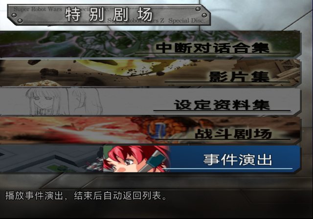
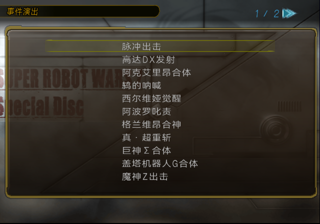
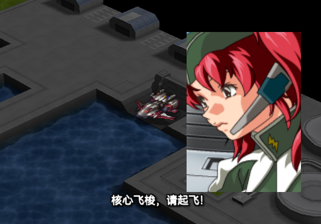
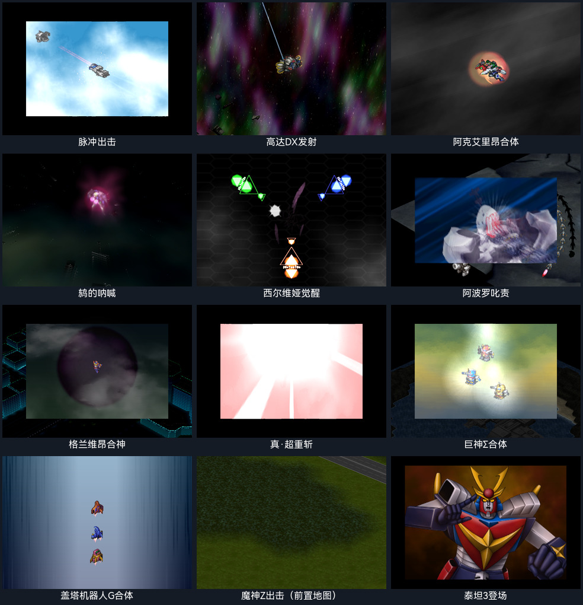
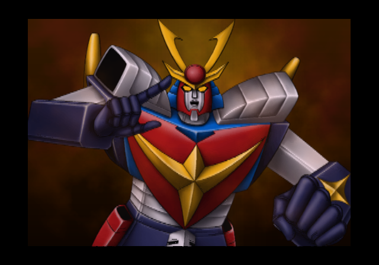
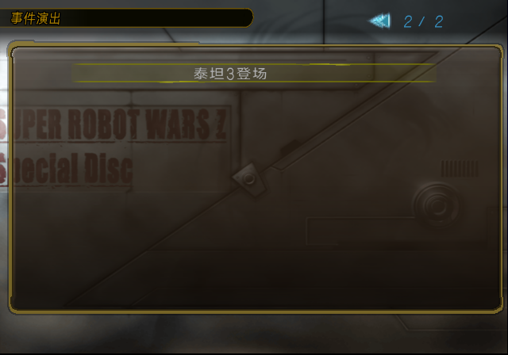

# SP 特别剧场事件演出鉴赏候选（2026-10-13）

后续横幅已改为“美玲＋脉冲出场”，并统一为原入口的黑色粗体标题，见[横幅第二版](SP_EVENT_GALLERY_BANNER_20261013.md)。本页保留首版候选及其12项流程证明；新版另有独立ISO和运行记录。

整理更新：首版与其重复构建ISO已在确认哈希后清理，本页保留历史流程证明。当前新版已放入ARMSX2扫描目录 `build/iso/special-disc/event-gallery/sp-event-gallery-ui-v2.iso`。

当前 SP 汉化版已增加“特别剧场 → 事件演出 → 原生分页列表”。列表包含12项、13个effect，点击后独立加载地图和事件脚本；收到原生演出完成信号后，自动回到同一个列表并保留页码、选中项。脉冲串联273和274，并带4句底部中文字幕。

本次完成的是候选功能及LRPS2冷启动流程验证。PCSX2人工验收仍待进行；各演出的原关卡独立机体、背景音乐和部分初始构图仍需继续还原。

## 入口与字幕







字幕位于640×448画面的底部居中，约在x64～576、y384～416区域。字外透明，采用白字、黑色描边和轻微阴影，没有黑底矩形。字幕是独立的effect图元，不绑定美玲立绘。新图元带专用标记，在绘制时禁用地图的destination-alpha裁剪并通过深度测试；因此不会被地图遮住。未标记的原图元保留原绘制行为。

目前只有脉冲的4句带中文字幕，来源为本地Whisper日语识别，已调整术语；逐句听校仍待完成。其他11项当前保留原语音，尚未加中文字幕。

## 场景与流程证据

| 列表项 | Effect | 地图 | 本轮验证范围 |
| --- | --- | --- | --- |
| 脉冲出击 | 273 → 274 | 30 | 点击播放、后半段、4句字幕、自然结束返回；重复播放 |
| 高达DX发射 | 255 | 3 | 点击播放、自然结束返回 |
| 阿克艾里昂合体 | 256 | 13 | 点击播放、自然结束返回 |
| 鸫的呐喊 | 257 | 74 | 点击播放、自然结束返回 |
| 西尔维娅觉醒 | 258 | 70 | 点击播放、自然结束返回 |
| 阿波罗叱责 | 259 | 63 | 点击播放、自然结束返回 |
| 格兰维昂合神 | 264 | 8 | 点击播放、自然结束返回 |
| 真·超重斩 | 265 | 63 | 点击播放、自然结束返回 |
| 巨神Σ合体 | 266 | 45 | 点击播放、自然结束返回；较长地图物件前置动画 |
| 盖塔机器人G合体 | 267 | 26 | 点击播放、自然结束返回 |
| 魔神Z出击 | 269 | 72 | 点击播放、自然结束返回 |
| 泰坦3登场 | 282 | 22 | 第二页点击播放、自然结束返回第二页 |

验证使用最终候选ISO冷启动LRPS2，输入原生按钮导航，未加载模拟器存档、未修改运行中代码或强制设置结束状态。原始输入、截图和状态观察记录见[运行日志](issue-assets/sp-event-gallery-20261013/commands.jsonl)，自动核对结果见[流程报告](issue-assets/sp-event-gallery-20261013/flow-report.json)。截图以报告中的实际phase、row和frame为准；原始截图名称不是场景身份凭据。

本轮使用Software renderer、隔离的记忆卡副本，从frame0启动并运行至frame35126。候选、核心、驱动、记忆卡种子及日志哈希见[运行来源记录](issue-assets/sp-event-gallery-20261013/runtime-provenance.json)。

流程状态依次为 `1 请求 → 2 播放 → 3 原生结束 → 0 列表`。验证脚本要求每项完整经过该链路，回到列表时保留条目，并覆盖全部12项。它验证流程和状态，不代替逐帧视觉检查或PCSX2人工验收。

最终记录包含15次完整播放，覆盖全部12项。验证器还通过负例检查：删去最后一项会报覆盖不足，插入内存写入或删除结束状态记录会拒绝通过。状态0本身只证明鉴赏播放已空闲；是否显示列表、根菜单及保留选中项，另外结合截图和原生UI实现判断。

原生列表每页11行，第2页的泰坦3全局索引为11。原生选择函数已经返回“页号×每页行数＋页内行号”，无需另加偏移。演出期间不销毁列表对象，返回后第二页及选中项继续保留。

四句字幕均已在最终候选中截图检查；脉冲在完成其他场景后再次播放成功。最终还检查了从列表退出到特别剧场，再重新进入事件列表的操作。







## 原地图如何加载

特别剧场仍使用原生UI状态。在新入口的选择回调中记录场景，下一帧保存并隐藏现有单位，清理动态effect，加载该条目对应地图、设定镜头，随后运行独立事件脚本。播放帧调用原生地图、事件解释器、镜头及effect更新链。

脚本使用原生的effect等待指令，等演出真正结束后进入返回阶段。返回时释放地图和动态资源、恢复单位标志和剧场VRAM，再继续绘制原来的列表。没有按固定秒数强行返回。巨神Σ的地图物件前置动作会延迟effect加载，验证也确认会等待整段完成。

当前保留了273、266、267、269所需的原地图物件时序。脉冲由前置地图物件、273、间隔、274组成。其余effect也各自加载对应原地图，不需要原关卡推进到触发位置。

保真边界：257原剧情继承动态单位坐标，本候选明确选择地图74的 `(13,7)` 作为独立锚点；部分初始镜头方向使用默认值3。独立关卡单位（例如密涅瓦）及关卡BGM还未全部移植，不能将本轮流程通过解释为原关卡构图完全还原。

## 构建与静态验证

源代码位于 `tools/special_disc/event_gallery/`，配置为 `config/products/special-disc/event-gallery.json`。运行：

```sh
python3 tools/special_disc/event_gallery/build.py
```

输入 `build/iso/special-disc/sp-current.iso`，输出独立候选 `work/iso/sp-event-gallery-zh.iso`。构建工具禁止覆盖生产SP、输入ISO及rom目录；完成回读后才替换最终候选。依赖说明见[构建说明](../tools/special_disc/event_gallery/README.md)。

候选ISO SHA-256：

```text
f06a8ef7cc2d35acc1aa7a55d8b223a9613f02de885f304818b329cd868d7d40
```

独立重复构建得到同一完整ISO哈希。生产SP中ELF仍为 `71480201a1ab430fa0f6229a39f0c2bd5d9e48a3f060addea0fe0cda9424392f`，候选ELF为 `65c99b6e46b407d6adceb3f962b332c3476cc9acc9d4a817e5c5838f0b1eac9a`。

- ELF和AID扩展后附加到候选尾部；其余63个成员的LBA及尺寸保持。
- ISO9660与UDF的65个成员extent和尺寸一致；更新的UDF元数据通过tag checksum及CRC检查。
- 同步游戏实际读取的 `VMAP.DAT`：AID记录从LBA1231124、38793扇区改为LBA1853434、38809扇区。只更新ISO目录不足以让游戏读到新横幅。
- AID块2扩展后同步两套原生offset/decoded-size表；原5张横幅图像、调色板及其他记录保持字节一致。
- 脉冲effect273的资源槽chunk274保留35,869个原图元，新增577个字幕图元；压缩资源为207,051字节，仍在原槽位预算内。SP语音编号339～342保留。
- 全部303个原始主VEFF动画共2,452,673个图元的专用标记位均为0，未发现与字幕标记冲突。
- ELF、AID、VMAP及字幕资源已回读；Python源码编译检查通过。

构建与静态证明见[静态验证摘要](issue-assets/sp-event-gallery-20261013/static-proof.json)。7-Zip的ISO视图另行回读了目标成员；原始SP本身存在大于1GB声音文件的UDF shortAD兼容问题，不能把7-Zip UDF读取当作本次通过项。UDF证明来自项目的严格元数据与extent检查。

本候选未覆盖生产SP，未提交或推送。后续优先补PCSX2人工体验、剩余语音字幕与原关卡舞台保真。
