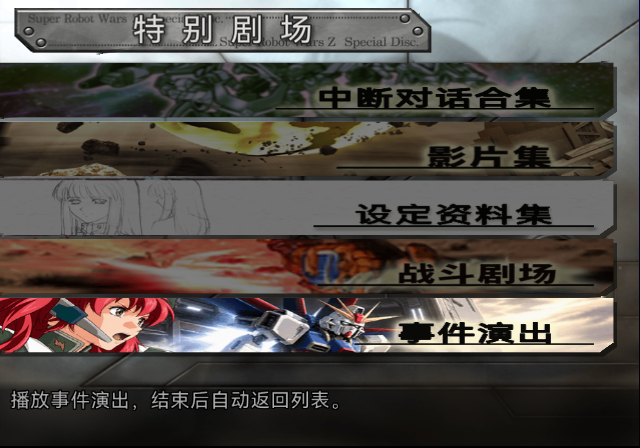
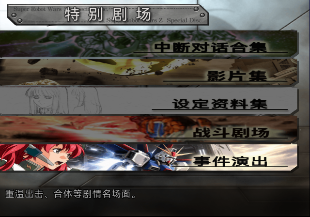
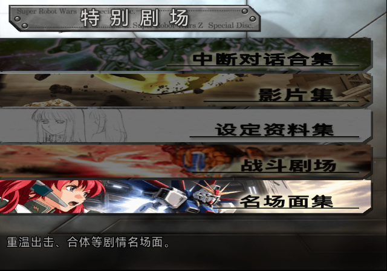

# SP 事件演出横幅第二版（2026-10-13）

按本轮要求，将特别剧场的“事件演出”入口改为“美玲＋脉冲出场”：左侧美玲呼叫出击，中央脉冲从机库出舱，右侧浅色区域显示标题。底图使用内置 image_gen 制作，文字由现有游戏标题模型确定性绘制。



## 标题与原入口统一

“事件演出”复用 `tools/special_disc/images/rebuild_banner1.py` 中“中断对话合集”的字形和排版函数，不采用生成图中的文字：

- 项目锁定的 HarmonyOS Sans SC Regular，加粗1.125px，8倍采样；横向em37.3333、纵向em30.6849，字距39.5px。
- 黑色字墨RGB `(9,9,8)`，浅米黄外光，正体；四字范围为 `(405,35)-(557,65)`。
- 黑色下划线为x361～599、y65～66，与原入口使用相同高度及右边界。
- 横幅保持原620×78艺术区和透明斜角轮廓；新图仍使用独立第6组CLUT。


这保证新标题与现有入口使用相同的确定性字形模型。现有“影片集”“战斗剧场”中文曾来自用户提供的AI成图，不能据此断言它们的实际字体文件；本次沿用项目已校准的黑粗字模型来统一形态。

## 来源与重作

选定无字底图：[meyrin-impulse-background.png](../tools/special_disc/event_gallery/assets/source/meyrin-impulse-background.png)。内置image_gen的两轮提示词和参考角色见[生成记录](../tools/special_disc/event_gallery/assets/source/imagegen-provenance.json)：先生成美玲与脉冲出舱横幅，再去掉生成文字，接回原生标题模型。

显式作者工具为 `tools/special_disc/event_gallery/author_banner.py`，依赖NumPy和Pillow。当前可用Python为桌面自带依赖环境；普通构建仍只消费锁定的索引快照。

```sh
python3 tools/special_disc/event_gallery/author_banner.py \
  --background tools/special_disc/event_gallery/assets/source/meyrin-impulse-background.png \
  --crop 0 220 2169 293 \
  --outdir work/authoring/sp-event-gallery-ui-v2
```

裁剪参数为左、上、宽、高，实际范围 `(0,220)-(2169,513)`。源图透明边先铺暖灰，再缩放、绘制文字并施加原生alpha。新palette固定index0透明、index1为精确黑墨，其余色位用于底图和抗锯齿。来源、字形参数、输出哈希见[作者回执](../tools/special_disc/event_gallery/assets/asset-receipt.json)。

## 候选与验证

新版候选已移入ARMSX2现有递归扫描目录，实际文件为 `build/iso/special-disc/event-gallery/sp-event-gallery-ui-v2.iso`。旧 `work/iso/sp-event-gallery-ui-v2.iso` 保留兼容符号链接，不另占一份ISO。文件大小3,875,848,192字节，SHA-256为：

```text
99af61ba50398fe62d4288e5358117563b2c51c628a87050a557191e13b608a2
```

构建：

```sh
python3 tools/special_disc/event_gallery/build.py \
  --output build/iso/special-disc/event-gallery/sp-event-gallery-ui-v2.iso \
  --workdir work/build/sp-event-gallery-ui-v2
```

静态检查：两次显式作者运行得到相同PNG、picture与CLUT字节；字体锁、字形bbox、原alpha、透明色、黑墨色、CSM1 CLUT及swizzle回读均通过。原5图、5组CLUT及其他记录保持字节一致。ISO9660和UDF的65个成员extent、尺寸一致，原生VMAP的62条记录与ISO对应；AID新位置为LBA1853434、38813扇区。

与[首版流程候选](SP_EVENT_GALLERY_20261013.md)比较，新版ELF高RAM的65,536字节菜单/运行时payload完全相同，整个VEFF成员也相同，因此此次未改变播放脚本或中文字幕资源。首版15次播放覆盖12项的证明保留在原记录中。

本轮另以新版ISO冷启动LRPS2，检查选中与未选中横幅、进入事件列表、播放脉冲字幕、自然结束回到列表、退出回到特别剧场。运行输入和状态观察见[日志](issue-assets/sp-event-gallery-banner-20261013/commands.jsonl)，新版运行摘要见[验证记录](issue-assets/sp-event-gallery-banner-20261013/validation.json)。本轮未在新版重跑全部12项，PCSX2人工验收仍待进行。

ARMSX2已配置 `RecursivePaths = /Users/nate/Super-Robot-Wars-Z/srwz-zh/build/iso/`，因此文件移入后即可被扫描，无需修改模拟器配置。移动后完整SHA-256复核一致。

已清理本次的首版ISO、重复构建ISO和早期语音鉴赏原型ISO，共3份；保留截图、流程日志、哈希及构建记录。生产SP、原盘及其他问题的验证镜像均保留。清理明细见[ISO清理记录](issue-assets/sp-event-gallery-banner-20261013/iso-cleanup.json)。本次文件管理未启动游戏，也不新增ARMSX2运行验收结论。未提交或推送。

## 标题改高、减细（2026-10-14）

用户验收时指出“事件演出”的“事”字压得太扁、看不清。原标题沿用“中断对话合集”校准出的字形盒
（em 37.33×30.68、加粗 1.125 px），“事”七道横在 30 px 高度里加粗后糊成一团。`author_banner.py`
新增两个显式参数：`--title-height-scale`（只放大纵向 em，墨迹底边保持在原生基线 y=65）与
`--title-stroke-px`（覆盖描边宽度；原校准仍用原生描边计算 em，再以新描边渲染）。对比
1.0／1.1／1.2／1.3／1.4 倍高与 1.125／0.75／0.5 px 描边后，用户指出 1.3 倍高比原生条目大，最终采用
**原生高度（1.0）、0.75 px 描边**——可读性主要来自减细；墨迹范围 `(405, 35, 557, 65)`。

```sh
python3 tools/special_disc/event_gallery/author_banner.py \
  --background tools/special_disc/event_gallery/assets/source/meyrin-impulse-background.png \
  --crop 0 220 2169 293 --title-height-scale 1.0 --title-stroke-px 0.75 \
  --outdir work/authoring/sp-event-gallery-banner-h1.0-s0.75
```

原生 TIM2 模板 `work/analysis/sp-aiddata-images-20260912/tim2/block-002-tim2-01.tm2`（SHA-256
`fe0ea80b…`）在 10-13 的清理中被删，本次从原盘 AID 块 2 解码重新导出，哈希一致。新快照：
picture `801d723087e7…`、CLUT `55af4f54a46b…`。同批把入口说明改为"重温出击、合体等剧情名场面。"（去掉"播放结束后自动返回"）。



## 改名"名场面集"（2026-10-14）

用户选定条目名为**名场面集**（候选还有剧情演出、演出剧场、地图演出等；"事件"是日文イベント的直译，
中文里偏干）。改动只有两处字符串：`author_banner.py` 的 `TITLE`（横幅标题，重渲染为 1.0 高、0.75 px 描边）
与 `menu.py` 的 `label`（菜单项／列表标题共用）；列表条目名、帮助行不变。



