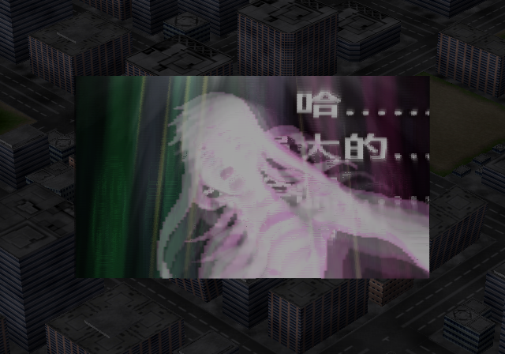
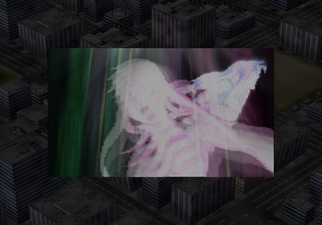

# SP事件演出第四版：原图覆盖与点击过渡修复（2026-10-13）

本页为历史记录。最新[第六版](SP_EVENT_STAGE_AND_SUBTITLES_V6_20261013.md)已补齐魔神Z末尾单位替换，并修正第五版2128帧为原指令的2160帧；本页旧候选路径及未完成项按当时状态保留。

后续用户发现魔神Z舞台不完整，已独立复现并补回前置状态及物件时序，见[第五版魔神Z修复](SP_EVENT_MAZINGER_STAGE_20261013.md)。本页12段通过指流程及本页两处修复范围，不代表全部原关卡画面保真通过。

第四版修复候选已通过全部12段的自然播放返回，另复测脉冲和阿克艾里昂，共14轮。原图及调色板静态核对、3个针对性回归测试、ISO回读通过。用户随后明确指定使用LRPS2验收，本轮要求的验证已通过；未进行第四版ARMSX2人工验收，不将LRPS2结果称为硬件验收。

## 阿克艾里昂原图被字幕覆盖

用户指出的是演出图片内部出现中文，确实是第三版错误。旧代码仅把 `quad[0] & 2` 的绘制记录计入纹理使用情况，漏掉了 `0x19` 等另一类记录；effect256的8位图片1被166条记录引用，覆盖原生第774～939帧，却被误判为空闲并替换成中文字幕图集。

“原动画记录不变”以及此前受错误筛选条件限制的“已用像素保留”检查，均不足以证明实际原图未变。此前对用户作出的“原演出图没有变化”判断不成立。

修复后禁止覆盖任何既有图片，字幕一律追加独立图片；纹理引用检查不再依赖这项flag筛选。effect256改用4位纹理组追加图片2、调色板7。全部12个加字幕effect的所有原有4位/8位图片像素，以及各类记录声明引用的调色板均已重新核对通过。原来未加字幕的274保持原样。

第三版错误画面：

第四版恢复后的画面：

[旧第二版未修改effect256的对应画面](issue-assets/sp-event-subtitles-20261013/v4-fixes/v2-original-image-baseline.png)作为运行对照。两次同一阶段的动画采样存在轻微帧偏差，不声称整张运行截图逐像素一致；原图片像素的一致性由[静态记录](issue-assets/sp-event-subtitles-20261013/v4-fixes/texture-preservation.json)证明。

## 点击任意演出时列表文字短暂变形

第三版逐帧复现显示：点击条目后已经进入地图加载阶段，旧列表画面仍留在显示缓冲中，出现向下错层、拖影和变形。第四版在地图初始化前清空两张显示缓冲，以短暂黑场衔接地图，避免旧列表继续被显示。

- 点击请求帧仍显示清晰列表。
- 第一加载帧已无列表字形；可见极淡的上一场边缘历史，不将其宣称为逐像素全黑。
- 下一帧全黑，随后地图正常出现。全部12段均采集了进入播放的黑场样本。
- 播放结束自然返回，保留上次选中项。

[第三版点击后变形帧](issue-assets/sp-event-subtitles-20261013/v4-fixes/v3-list-click-distorted.png) · [第四版请求帧](issue-assets/sp-event-subtitles-20261013/v4-fixes/request-frame.png) · [第一加载帧](issue-assets/sp-event-subtitles-20261013/v4-fixes/first-load-frame.png) · [下一加载帧](issue-assets/sp-event-subtitles-20261013/v4-fixes/second-load-frame.png)

用户目前未再发现边框抖动，此项保留历史记录，未作为本轮修复重点，也不标记为已修复。

## 验证及交付

- 回归测试：`tests/test_sp_event_gallery_records.py` 两项及 `tests/test_sp_event_gallery_textures.py` 一项（两种纹理容量情形）通过。
- 静态：12个字幕effect的所有原有图片像素和全部声明引用调色板保留，原动画、语音及模型记录保留；追加纹理未超出VRAM预算。
- ISO：构建的ISO9660、UDF、VMAP和ELF/AID/VEFF回读通过，见[构建记录](issue-assets/sp-event-subtitles-20261013/v4-fixes/build-receipt.json)。
- LRPS2：冷启动、隔离记忆卡副本、仅原生控制器输入；[14轮流程报告](issue-assets/sp-event-subtitles-20261013/v4-fixes/flow-report.json)覆盖全部12段，无宿主内存写入或即时存档加载干预。见[来源记录](issue-assets/sp-event-subtitles-20261013/v4-fixes/provenance.json)。脉冲及阿克艾里昂追加纹理后的底部字幕已有画面依据。
- 验收范围：用户明确回复“用LRPS2”，本轮以以上LRPS2结果验收，ARMSX2不再列为阻塞项。第四版未做ARMSX2人工验收，第三版硬件画面也不用于替代第四版结果。

第四版当时的扫描候选为 `build/iso/special-disc/event-gallery/sp-event-gallery-subtitles-v4.iso`，后续已移至 `work/iso/archive/sp-event-gallery-subtitles-v4.iso`；当前扫描候选是第五版。旧第三版移至 `work/iso/archive/sp-event-gallery-subtitles-v3.iso`，旧第二版也保留在archive中。第三版旧兼容路径保持指向其历史版本，第四版兼容路径为 `work/iso/sp-event-gallery-v4-review.iso`。文件移动及精确哈希见[安装记录](issue-assets/sp-event-subtitles-20261013/v4-fixes/install-receipt.json)。生产SP输入保持不变。

字幕沿用本次构建时的当前字幕源，与当前听校页源哈希一致，快照为[subtitle-source.json](issue-assets/sp-event-subtitles-20261013/v4-fixes/subtitle-source.json)。字幕仍待用户听校；本轮没有修改译文或全局术语表，没有commit或push。
