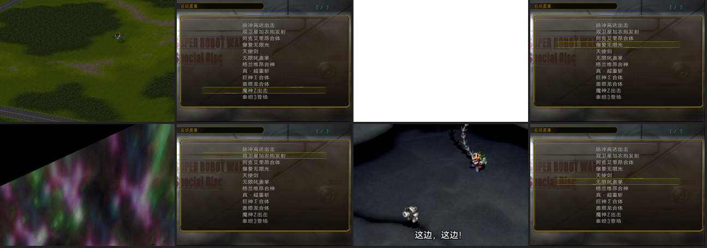

# 名场面集其余十项复核清单（2026-10-15）

爆爱无限光（切图回到原来的世界）与魔神Z出击（防护罩、两段音乐、物件从第 0 帧起）修正之后，按同样的尺度把其余十项的原脚本重新拉出更宽的窗口（段落起点到演出之后的下一个 END／对白为止，另扫描整个关卡的 `0x13bc` 切图与出场表），逐项核对：演出前的地图与机体、演出中隐藏／移除的机体、演出后的地图与机体、原脚本把机体放到固定格子的指令。窗口反汇编在 `work/analysis/sp-event-fidelity-20261013/`（`stagedis.py`、`spawnlist.py`），SP 盘上本页提到的所有 effect（251、268、20、21、15、33、31、28、44、10、9、22、8、1）都与日版本篇逐字节相同，地图 2～75 号同样相同。

机体位置分两类：**脚本固定**（出场表 `0x0d` 或对白框格子给出的坐标，可直接照搬）和**随玩家行动**（关卡开始时部署的我方／敌方单位，脚本只用 `P` 编号引用，坐标要由鉴赏自定锚点）。后者就是用户提出的"根据路线适当放几台我方的机体"要讨论的范围。

| # | 项目 | 原脚本演出前 | 原脚本演出后 | 鉴赏现状 | 建议 |
| --- | --- | --- | --- | --- | --- |
| 0 | 脉冲高达出击 | `0xa370～0xa7b0`：STAGE·D 下对白，史汀格／史黛拉／奥尔朝向 3，镜头奥尔，**深渊攻击亚历克斯的扎古**：以亚历克斯格子为中心连放 effect 15×3、effect 1×3、effect 8（`0xa4c0～0xa630`），再在他身上同步放 effect 33（`0xa760`）；然后 ＩＧＮＩＴＥＤ、镜头史汀格、光标隐藏、273。 | 274 之后 `0xaaa0` 出场组 5（扎夫特杂兵）、对白、战斗。 | 四机在场，273／274 隐显顺序一致；没有攻击前奏。 | **A1 可加**：273 前加"深渊攻击"前奏（镜头奥尔→亚历克斯格 (12,13) 周围爆炸 15/1/8→effect 33→ＩＧＮＩＴＥＤ→镜头史汀格），约 3 秒；所用机体都已在场。杂兵到场仍不放。 |
| 1 | 双卫星加农炮发射 | `0xb680～0xb840`：渐暗、切白、**切到地图 3**，镜头 (20,23) 视角 1，缩放 −11，**出场表 `0x8840`：加洛德／帕拉的 DX＋G 猎鹰在 (20,23) 朝向 3（动画出现）**，サテライト・キャノン，恢复绘制，从 0xf8 每帧 −8 渐亮，对白，`0x41 0` 转到视角 0，镜头加洛德，255 开始时才隐藏他。 | `0xb920～`：显示并撤下加洛德，**切回地图 57**（镜头 (3,16) 视角 3，缩放 −16），物件 0～4 归零、1～4 隐藏，显示阵营 12，（兰斯洛在场则镜头对准他），从 0xf8 渐亮，对白，**effect 251 在 (17,17)（炮击落点）**，物件 4 显示并播放到 499 帧，切白，渐暗。 | 直接从地图 3 视角 0 开始，无机体；650 帧后渐暗返回。 | **A2 建议补**：开头放 DX＋G 猎鹰（SP 单位待映射，Original 365/371，驾驶员 320/344）于 (20,23) 朝向 3，从 0xf8 渐亮、`raw 0x41 0` 视角 1→0 转场、镜头加洛德，特效开始时隐藏；**A3 建议补**：结尾按原脚本切回地图 57、渐亮、effect 251 落点与物件 4 动画，再渐暗返回——这是"演出后的地图"最典型的一例。兰斯洛随玩家，不放。 |
| 2 | 阿克艾里昂合体 | `0x8670～0x8880`：創聖のアクエリオン（脚本放曲）、镜头 (10,11)、effect 20 在 (11,10)、60 帧、对白、`0x41 3`、镜头 AI、三矢量朝向 1、对白、镜头 (11,4)。更早的段落里神话兽击落丽花的单位（effect 22、`0x13ae`）、∀高达出场 (6,22)、镜头在 (10,7)～(10,12) 间推移。 | 1538 帧出场太阳阿克艾里昂 (11,16)，对白，镜头罗兰。 | 三矢量 (11,4)(12,3)(10,3)，特效开始撤下，1538 帧出场，之后多停 60 帧。曲子由资源头播放（`bgm_pause`）。 | 基本一致。**可选 B1**：加 effect 20 前奏（(11,10)，60 帧）；但脚本提前放曲会被资源头再次触发而重头播放，所以曲子仍只能从特效起。∀高达 (6,22) 在镜头 (11,4) 之外，不放。 |
| 3 | 爆爱无限光 | 已修正（effect 21 前奏、切图回地图 25）。 | — | — | — |
| 4 | 天使剑 | `0x10620～0x10920`：切白后从 0xfc 每帧 −2 渐亮，对白，`0x1d` 把皮耶尔的机体切成アクエリオンエンジェル（Original 655→SP 704），皮耶尔朝向 1、诗翅朝向 3，镜头皮耶尔，对白，镜头 (13,6)，258 开始时隐藏两机。 | 1270 帧叠暗 0xfc→特效结束→**显示两机，从 0xfc 每帧 −2 渐亮**，8 帧后诗翅单位闪动，对白，战斗。 | 无机体；1270 帧后压暗返回。 | **B2 待定**：两机位置随玩家（皮耶尔在落点 (13,5) 附近、诗翅为敌方）。可按锚点放：天使型 (13,5) 朝向 1、诗翅的单位（Original 驾驶员 635→SP 657，机体待查）于其东侧朝向 3；开头从 0xfc 渐亮，特效起隐藏，结束后显示并渐亮约 2 秒再淡出。 |
| 5 | 无限叱咤掌 | `0x141c0～0x14490`：`0x41 2`、STAGE·D、对白，`0x1d` 把阿波罗机体切成ソーラーアクエリオン（Original 651→SP 700），**对白框给出阿波罗 (6,26)、双翅 (10,26)**，镜头阿波罗，阿波罗朝向 2、双翅朝向 0，对白，Ｇｏ　Ｔｉｇｈｔ！，镜头 (8,26)，259 开始时隐藏两机。布雷克路线（阿波罗不在）则布雷克在 (6,26) 朝向 2。 | 640 帧撤下双翅、出场光球；特效结束后显示阿波罗，对白，12 帧后再撤双翅，回关卡 BGM，战斗。 | 无阿波罗／双翅，640 帧出场光球 (10,26)。 | **B3 建议补**：阿波罗的太阳阿克艾里昂 (6,26) 朝向 2、双翅的单位 (10,26) 朝向 0（坐标来自对白框，可信），开头可见，特效起隐藏，640 帧撤双翅＋光球，结束后显示阿波罗并停留。路线：默认阿波罗；若要做布雷克版再议。 |
| 6 | 格兰维昂合神 | `0x9170～0x9430`：合神！ゴッドグラヴィオン（脚本放曲），四骑士对白框给出的最终坐标 (10,5)(12,5)(11,4)(11,8) 与朝向 1 已采用；**鸫的单位在 (6,8)**（`0x9280` 对白框、镜头两次对准它、`0x24` 闪动）；斗牙 (11,6)；镜头 (11,6)。 | 1415 帧撤四骑士、显示斗牙、`0x13bf` 合神登记；30 帧后 嘆きのロザリオ、对白。 | 四骑士＋斗牙在场，顺序一致。 | **A4 可加**：鸫的单位（SP 660/638）放在 (6,8)，镜头 (11,6) 时在画面内。其余远处机体（勝平／デューク／甲児 等在 (18～20,20～22)）不在画面内，不放。 |
| 7 | 真·超重斩 | `0x15600～0x156a0`：出场组 0xb、对白、嘆きのロザリオ、对白、镜头 (18,3)、渐暗到 0x80；265 开始时隐藏斗牙（神グラヴィオン）与布雷克的单位。 | 占位泽拉拜亚逐列爆炸后 `0x15b60～`：**镜头斗牙，显示斗牙与布雷克，停 180 帧**，光标，对白，紅ノ牙，从 0 渐暗到 0xf8，切白，撤下两机，换部署。 | 占位表与爆炸序列一致；无斗牙／布雷克。 | **B4 待定**：两机随玩家。可按锚点放在镜头 (18,3) 附近（神グラヴィオン Original 600→SP 644，斗牙 558→578；布雷克 774→807，机体待查），开头在渐暗前可见，特效起隐藏，结束后显示并镜头斗牙、停 180 帧、换曲 紅ノ牙 渐暗返回。 |
| 8 | 巨神Σ合体 | `0xa320～0xa460`：STAGE·D，镜头自律回路的单位，缩放 −19，`0x24` 闪动，对白，がんばれ！宇宙の戦士（脚本放曲），**对白框给出 (16,17)(17,17)(18,17)(17,18)** 四格，镜头 (18,18)。 | 2699 帧 `0x13b4` 编队、`0x13c1` 副驾驶连结、出场神Σ (17,19)；60 帧后 EN、120 帧、缩放 −11、对白。 | 只有神Σ出场；三机不在场。 | **B5 待定**：空雷王／海明王／陆震王（Original 82→SP 84，其余待查）按对白框放在 (16,17)(17,17)(18,17)，2699 帧与出场同时撤下。(17,18) 一格是谁待查。 |
| 9 | 盖塔龙合体 | `0xb790～0xb910`：（甲儿在场则镜头甲儿、朝向 2）、光标、缩放 −18（120 帧动画）、`0x13b8` 镜头 40 帧滑到 (25,30)、对白框 (14,23)、われらのゲッターロボ、镜头 (25,30)、隐藏阵营 0／12。 | 501 帧显示阵营 0／12、出场盖塔龙 (14,23) 朝向 2；120 帧后 EN、对白。 | 一致，但地图上除盖塔龙外没有任何机体，"显示阵营"没有对象。 | **B6 讨论**：原脚本只引用甲儿（镜头＋朝向 2）；可按路线放几台我方机体（例如魔神Z／甲儿在 (14,23) 附近），开头镜头对准、朝向 2，特效期间随阵营隐藏、结束后显示。放哪几台、放哪里请定。 |
| 10 | 魔神Z出击 | 已修正。 | — | — | — |
| 11 | 泰坦3登场 | `0x12cb0～0x12f50`：出场表 `0xec50`/`0xecb0`：万丈的ダイファイター（有芙则加芙的加布兰）从 (32,17)/(32,15) 出场，对白框给出最终位置 (18,17)(18,19)(18,15)，万丈／奥尔森／芙朝向 2，出场组 0xa／0xb，对白，カムヒア！ダイターン３，`0x1d` 变形为泰坦3，30 帧，万丈朝向 0，对白，镜头万丈，30 帧，282。 | 30 帧后对白，关卡 BGM。 | 泰坦3 (18,17) 朝向 0、奥尔森 (18,19) 朝向 2。 | 一致。**可选 B7**：芙的加布兰（Original 273→SP 288，驾驶员 250→257）(18,15) 朝向 2 受存档标志控制，按"路线"可选放。出场表的 (32,17) 是入场起点，`0x13b5` 走位到 (18,17)，鉴赏直接放终点即可。 |

## 建议的处理顺序

1. **A 类（原脚本明确、坐标确定）**：A2/A3 双卫星加农炮（DX 出场＋切回地图 57 的落点演出）、A4 格兰维昂加鸫、A1 脉冲前奏。做法与已完成的两项相同：配置时间线＋LRPS2 冷启动回放＋正式构建。
2. **B 类（坐标随玩家或涉及路线）**：B3 无限叱咤掌（坐标其实来自对白框，建议按表做）、B2 天使剑、B4 真·超重斩、B5 巨神Σ、B6 盖塔龙、B7 泰坦3。需要用户确认：放不放、放哪几台、朝向与格子。
3. 待查项：诗翅／双翅／布雷克／海明王／陆震王的 SP 机体编号（驾驶员编号已映射），以及 (17,18) 格的单位。

## 尺度说明

- 对白、立绘（`0x139d～0x16`、`0x13a3/0x13a4/0x13a8/0x13a9/0x13ab`）、战斗（`select/act`）、EN/气力赋值、编队登记一律不纳入。
- 每个镜头指令后补 `raw 0x1c 3`，否则战术光标会出现。
- 机体编号用 `names.resolve`（同名序数＋字节相似度）映射，放之前仍需在 LRPS2 里看一眼实际贴图。

## 处理结果（同日，用户决定全部做）

| 项 | 结果 |
| --- | --- |
| A1 脉冲前奏 | 已做：ＳＴＡＧＥ・Ｄ 下镜头奥尔，扎古 (12,13) 周围 effect 15×3／1×3／8，再 effect 33，换曲 ＩＧＮＩＴＥＤ、镜头史汀格；`effects` 列为 `[15,15,15,1,1,1,8,33,273,274]`（测试要求与时间线一一对应，含重复）。 |
| A2/A3 双卫星加农炮 | 已做：地图3视角1起，DX（SP 388／驾驶员 330）动画出场，0xf8 渐亮，`raw 0x41 0` 转视角，镜头加洛德，特效起隐藏；结束后撤下、`raw 0x13bc` 切回地图57（镜头 (3,16)，缩放 −16，物件归零）、渐亮、effect 251 落点与物件4动画、渐暗返回。G 猎鹰小队成员不单放。 |
| A4 格兰维昂加鸫 | 已做：鸫的单位 (6,8) 朝向1。 |
| B1 阿克艾里昂前奏 | 已做：镜头 (10,11)、effect 20（绿色光球）、60 帧；曲子仍由资源头起。 |
| B2 天使剑 | 已做：天使型 (13,5) 朝向1、诗翅的ケルビムマーズ (14,7) 朝向3；黑→亮开场、特效起隐藏、压暗、结束后显示并渐亮、停 60 帧淡出。 |
| B3 无限叱咤掌 | 已做：阿波罗的太阳阿克艾里昂 (6,26) 朝向2、双翅的ケルビム兵 (10,26) 朝向0；特效起隐藏，640 帧撤双翅出光球，结束后显示阿波罗。 |
| B4 真·超重斩 | 已做：神グラヴィオン (18,4) 朝向0、ソル═グラヴィオン (20,2) 朝向2；斩击后镜头斗牙、显示两机 180 帧、换曲 紅ノ牙、渐暗返回。 |
| B5 巨神Σ | 已做：空雷王 (16,17)、海鳴王 (17,18)、陸震王 (18,17)（(17,17) 在地图45上不可停留，出场时被推到 (17,16)，改用第四个对白框格子），合体时撤下。 |
| B6 盖塔龙 | 已做：甲儿的魔神Z (12,23)、铁也的大魔神 (16,23)；开头镜头甲儿、朝向2，再切 (25,30)。 |
| B7 泰坦3 | 已做：芙的加布兰 (18,15) 朝向2。 |

机体编号来源：诗翅＝ケルビムマーズ（STAGE128 单位表 `0xdff2`，669→SP 718）、双翅＝ケルビム兵（STAGE107 `0x1253c`，676→725）、布雷克＝ソル═グラヴィオン（STAGE107 `0x12644`，627→676）、神グラヴィオン 600→644、ソーラーアクエリオン 651→700、アクエリオンエンジェル 655→704、空雷王 82→84、海鳴王 99→101、陸震王 100→102、DX 365→388、ギャプラン 273→288；驾驶员 612→634、635→657、602→623、633→655、774→807、558→578、320→330、250→257。

实测说明：`visible`（`0x1388 → 0x910e`）确实隐藏单位（单独实验 `probe-hide`：隐藏 60 帧内画面上没有单位）；特效期间画面上仍出现的"机体"是特效自己绘制的贴图（天使剑的天使与目标、叱咤掌的目标），这正是原脚本在特效前隐藏实际单位的原因。另外 `0x56` 起特效的记录会在资源载入期间阻塞脚本约百帧，其后的隐藏指令相应延后，与原脚本相同。

正式镜像：`sp-current.iso` SHA-256 `725b7461945b04386c8f5d9cf94ee2322ca1050f1329f527186b0c9e66f9eca8`（ELF `d9575d8b…`，批次 `work/editions/23b0fbfb…/sp.json`），`verify_editions.py` 通过，全套 769 项测试通过。十项在正式镜像上的 LRPS2 冷启动回放见下节。

## 正式镜像回放（LRPS2，冷启动、隔离记忆卡、原生按键，两个并行实例各播五项）

| 项 | 帧数 | 返回后名册 | 状态区域 | 画面 |
| --- | ---: | --- | --- | --- |
| 0 | 2585 | 相同 | 相同 | [montage](issue-assets/sp-event-fidelity-20261014/review-20261015/row0-montage.png) |
| 1 | 1550 | 相同 | 相同 | [montage](issue-assets/sp-event-fidelity-20261014/review-20261015/row1-montage.png) |
| 2 | 1820 | 相同 | 相同 | [montage](issue-assets/sp-event-fidelity-20261014/review-20261015/row2-montage.png) |
| 4 | 1790 | 相同 | 相同 | [montage](issue-assets/sp-event-fidelity-20261014/review-20261015/row4-montage.png) |
| 5 | 1090 | 相同 | 相同 | [montage](issue-assets/sp-event-fidelity-20261014/review-20261015/row5-montage.png) |
| 6 | 1800 | 相同 | 相同 | [montage](issue-assets/sp-event-fidelity-20261014/review-20261015/row6-montage.png) |
| 7 | 1850 | 相同 | 相同 | [montage](issue-assets/sp-event-fidelity-20261014/review-20261015/row7-montage.png) |
| 8 | 2890 | 相同 | 相同 | [montage](issue-assets/sp-event-fidelity-20261014/review-20261015/row8-montage.png) |
| 9 | 850 | 相同 | 相同 | [montage](issue-assets/sp-event-fidelity-20261014/review-20261015/row9-montage.png) |
| 11 | 480 | 相同 | 相同 | [montage](issue-assets/sp-event-fidelity-20261014/review-20261015/row11-montage.png) |

记录：`work/analysis/sp-event-fidelity-20261013/probe-review-prod-{A,B}/`（scene-test.json、commands.jsonl、截图）。

## 无限叱咤掌尖叫被截（同日第二次修正）

用户提供了本篇关卡事件与鉴赏的两段录像。按标题卡与爆炸对齐（相差 3.0 秒）后：原作尖叫响的部分约 1.1 秒，之后约 1.5 秒逐渐衰减的尾音延续到弹坑出现之后；鉴赏只有约 0.65 秒，随后只剩 BGM，即尖叫在起声约 1 秒处被切断。

机制：尖叫（ccc 222）是双翅的台词，自特效第 580 帧起；原脚本 `0x14520` 在 640 帧等待后撤下双翅。原作的 `0x139b` 异步起动，640 帧从"请求特效"起算，而特效要等资源载入完才走自己的第 0 帧，撤人实际落在特效约第 540 帧，在尖叫之前；鉴赏的 `0x56` 等载入完成才返回，撤人正好落在尖叫起声 1 秒处，引擎撤下单位时把她的语音停掉。

处理：`remove_pilot 655` 移到 `wait_effects` 之后。双翅自特效开始已隐藏，光球仍在 640 帧出现，画面不变。另外，LRPS2 的音频输出里没有语音通道（频谱无谐波、改法不同录音却逐字节相同），所以语音长度只能靠真机／ARMSX2 录像核对，LRPS2 只用来确认画面与状态恢复。

正式镜像：`sp-current.iso` SHA-256 `64509362dce765dbeb6ba9b44ce5bd39be040ec18347511d7e4172bb21ab4dfa`（ELF `9534b23e…`，批次 `work/editions/c19387f7…/sp.json`），`verify_editions.py` 通过，全套测试通过；第 5 项 LRPS2 回放见 `work/analysis/sp-event-fidelity-20261013/probe-voice-prod/`。待用户用 ARMSX2 复核尖叫长度。

## 无限叱咤掌：光球出场时机（第三次修正）

撤人挪后仍短。再对两段录像：从尖叫起声到光球出现，原作约 2.4 秒，鉴赏约 1.3 秒。即原作里 `wait 0x280` 之后的出场组实际落在特效约第 705 帧（`0x139b` 让特效计数在资源载入期间就开始走），鉴赏的 `0x56` 等载入完成才返回，落在第 643 帧；而**出场指令本身会停掉当前语音**，所以原作的尖叫也是被出场切断的，只是晚约 1 秒。时间线改为 `wait 705`，双翅撤下仍放在特效结束后。正式镜像 `9b261fe5…` 之后随取消功能一起并入 `0817f1ae…`。

## 中途取消与魔神Z结尾（同日）

用户要求：魔神Z结尾等得太久；所有演出能否中途取消返回。

- 魔神Z主题曲段停留从 600 帧缩到 300 帧（约 5 秒）。
- 运行时新增取消：播放中（状态块 +0x34 帧计数 ≥ 20 帧后，避开列表的确认键）检测手柄按住掩码 `0062514c` 的新按下（+0x38 存上一帧掩码做边沿；原生的触发字 `0062514e` 对 ×／○ 会被冻结的列表控件消耗，所以不用它），× `0x0040`、○ `0x0020`、START `0x0800`（原始手柄字节序）。命中后清掉本帧的触发字副本 `0062514e/52/54/56`（否则列表控件恢复后会把同一个 × 当作"返回"关掉列表）、把清屏色（gp−0x79fc 三字节 `004cae74/78/7c`）归零并 `FUN_001c21b0(0,1)` 恢复地图层（撤销脚本可能留下的 `0x13ac 2` 白屏），置阶段 3 并直接走既有的完成路径（清特效与语音、关叠色、释放常驻特效块、恢复占位表、释放地图、清脚本状态、恢复名册与快照区域、恢复剧场 BGM 与 UI）。手柄结构位置用 LRPS2 在列表按住 L1／R1 做内存差分得到（`tools/find_pad.py`）。
- 帮助文案改为「重温出击、合体等剧情名场面。播放中按×可返回。」
- 实测（LRPS2，`tools/cancel_test.py`）：第 10 项第 600 帧按 ×（防护罩中）、第 3 项第 985 帧按 ×（闪光后切图的白屏期）、第 1 项第 950 帧按 START（地图 3）、第 5 项第 300 帧按 ○，均在 5 帧内回到列表并保留选中项，名册、关卡标志、缩放、占位表、BGM（99）与清屏色逐字节恢复；取消后再选其他项正常播放。资源载入期间（`0x56` 阻塞约百帧）按键会在载入完成后生效。

正式镜像：`sp-current.iso` SHA-256 `0817f1ae6d3e8663a9fa9e6a3f6bddabe9ef33dbbe3a8b6c937aaa330347b019`（批次 `work/editions/a9a1eaff…/sp.json`），`verify_editions.py` 通过，全套测试通过。

用户在 ARMSX2 上复核：改为 `wait 705` 后无限叱咤掌的语音长度与原作一致（2026-10-15）。

## 用户反馈后的修改（2026-10-15 晚）

- **爆爱无限光（#3）机体**：鸫原先放的是ディクリール（SP 660），不对。原版 Original 机体 616 只是编号与驾驶员 616（つぐみ）相同，并不是她的座机。STAGE117 在演出前 `0x12b20`／`0x12b50` 的两条 `0x1d` 与天使剑同样，把阿克艾里昂切成アクエリオンエンジェル（Original 655）；机器人图鉴也把“哀天使剑”和“爆爱无限光”列为同一形态的必杀技。现改为 SP 704，驾驶员仍为 638（つぐみ）。
- **巨神Σ合体（#8）**：用户决定开场不显示空雷王、海鸣王、陆震王三台，本项恢复为只在合体后出场神Σ。
- **天使剑（#4）**：列表名改为“哀·天使剑”；字幕“悲伤的……”“天使剑！”合并为一条“哀·天使剑！”（帧 275～495）。
- **真·超重斩（#7）**：字幕“合神——超重斩！”按原音拆为吼叫“哈啊啊啊——！”（帧 760～928）与“真·超重斩！”（帧 928～1136）。原音 0～2.2 秒吼叫，2.8 秒起喊技名。
- **魔神Z出击（#10）**：字幕“飞行器，合体！”改为“Pilder On!”。

以上均已在 LRPS2 上用正式镜像截图核对，截图在 `work/analysis/sp-caption-packet-20261014/` 下的 `fidelity-fix-20261015/`、`zan-split-20261015/`、`caption-merge-20261015/`、`list-rename-20261015/`。
