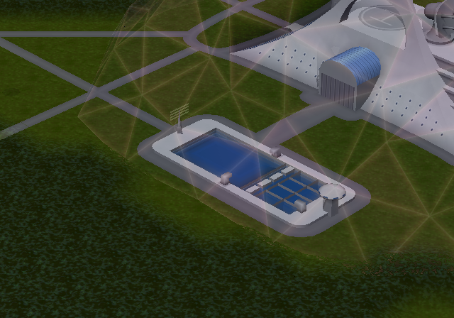
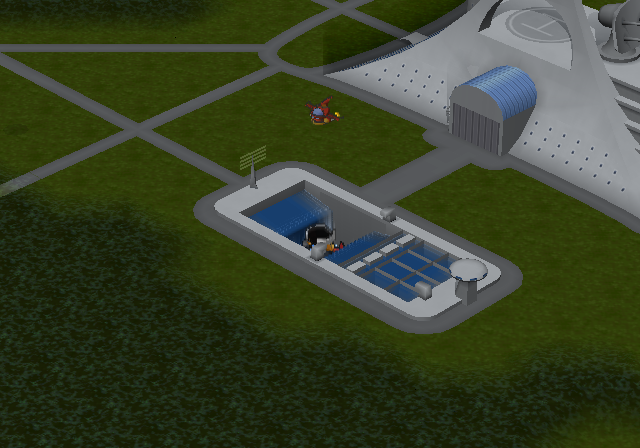
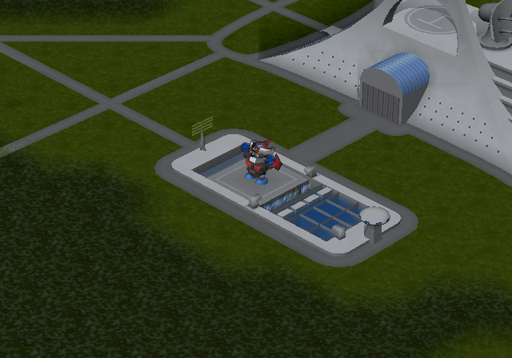

# 魔神Z事件演出：舞台继承状态与完整物件时序

本页为历史记录。最新[第六版](SP_EVENT_STAGE_AND_SUBTITLES_V6_20261013.md)已补齐魔神Z末尾单位替换，并修正第五版2128帧为原指令的2160帧；本页旧候选路径及未完成项按当时状态保留。

用户报告魔神Z的机体、舞台或镜头不正常。本轮使用用户指定的LRPS2复现：第四版可以完成播放返回，但前半段场内没有预期的驾驶舱飞行器，后半段泳池没有正常展开、魔神Z没有出水。原来的12项流程通过不能证明这些画面正确。

## 根因与修复

原关卡STAGE 047并非从一张刚加载的地图开始播放effect269。此前的effect268及其配套指令（0xaf40～0xafd0）已经将地图72的五个物件推进到第1600帧。鉴赏从新地图的第0帧开始，却直接运行后续到1724帧的动作指令；此外，只移植了第一组动作，遗漏了2128、3240、3399帧的后续阶段。

第五版先调用SP原生物件初始化函数，将物件1～5设为1600帧并保持，显示1、2、3、5，隐藏4；随后移植原脚本各组物件动作和等待。原脚本0x9f40明确设置镜头方向3，本次把配置中的默认值改成显式3，没有猜测新方向。地图、effect、语音和字幕资源本身不变。

原关卡依据见[舞台指令及前置依赖](issue-assets/sp-event-subtitles-20261013/v5-mazinger/stage-source.json)。代码位于 `tools/special_disc/event_gallery/runtime.S` 和 `runtime.py`。

## 画面与验证

第四版对应画面只有研究所泳池：

第五版已经出现飞行器飞入、泳池展开和魔神Z出水：

合体后场内保留魔神Z机体：

两次魔神Z完整自然播放均已返回列表，均为1907个模拟帧，保留第11项选中状态；另复测脉冲和阿克艾里昂各一次，播放返回通过。共4轮，未重新执行全部12项，不能把第四版14轮记录作为第五版全12项验收。见[本轮流程](issue-assets/sp-event-subtitles-20261013/v5-mazinger/flow-report.json)及[来源记录](issue-assets/sp-event-subtitles-20261013/v5-mazinger/provenance.json)。验证使用LRPS2 Software renderer，冷启动、隔离记忆卡、原生控制器输入、只读内存观察，没有即时存档加载或宿主内存写入。

三个已有的记录打包及原图保留回归测试通过。ISO构建回读通过；与第四版比较，所有非ELF成员逐字节一致，ELF变化仅在鉴赏私有段内，见[成员比较](issue-assets/sp-event-subtitles-20261013/v5-mazinger/v4-v5-member-audit.json)。因此本次没有重新修改演出图片或字幕稿。

## 尚未完全还原的部分

原关卡在0xa310隐藏演出物件5，并在0xa320生成可操作的魔神Z单位。独立鉴赏尚未移植这一步，当前保留物件5的站立模型，避免末尾机体消失。不能将本轮修复称为原关卡单位状态完全还原，也未做ARMSX2验收。

当前候选为 `build/iso/special-disc/event-gallery/sp-event-gallery-subtitles-v5.iso`，SHA-256为 `e9927ca213574e8519f3efc00a4f837b50f5899b4253f8d245205605a84aaf76`。第四版移至 `work/iso/archive/sp-event-gallery-subtitles-v4.iso` 留作回退，兼容链接同步更新，见[安装记录](issue-assets/sp-event-subtitles-20261013/v5-mazinger/install-receipt.json)。字幕仍使用当前37句听校稿，白字黑描边阴影、底部居中、字号26；没有commit或push。
