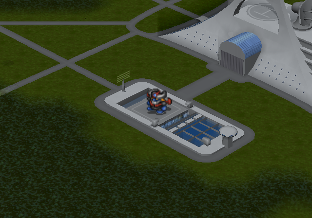
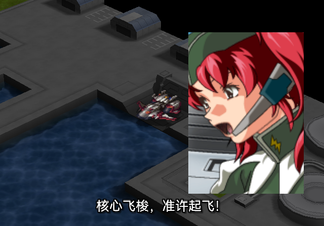
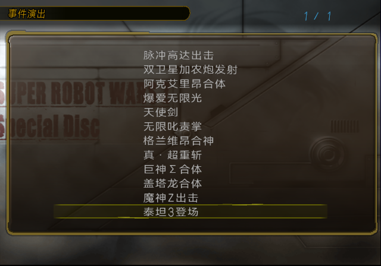

# SP事件演出第六版：舞台初始化、魔神Z单位替换与4倍字幕渲染

后续安排：用户要求鉴赏完整性先记录、以后再做，具体差异见[完整性待办](SP_EVENT_COMPLETENESS_BACKLOG_20261013.md)。当前轮仅改善字幕，第六版记录及其截图保留为历史。

第六版完成魔神Z末尾由演出模型到原生地图单位的替换，并补齐其他演出查到的模型初始帧与显隐状态。37句字幕采用此前润色稿，列表采用用户确认的12个标题；字幕沿用项目的4倍渲染再缩回流程，最终字号和位置保持不变。

LRPS2 Software冷启动、隔离记忆卡、原生按键操作完成13轮播放返回，覆盖12项，其中魔神Z两轮。连续只读状态观察确认请求、播放、自然结束、返回四阶段，没有宿主内存写入、即时存档加载或直接函数调用干预。见[流程报告](issue-assets/sp-event-subtitles-20261013/v6-stage-subtitles/flow-report.json)、[完整命令](issue-assets/sp-event-subtitles-20261013/v6-stage-subtitles/commands.jsonl)、[来源与精确版本](issue-assets/sp-event-subtitles-20261013/v6-stage-subtitles/provenance.json)。这是用户指定的LRPS2验收，未进行本版ARMSX2或PCSX2人工验收。

## 魔神Z末尾替换

原关卡STAGE047在末尾隐藏模型5，再生成位于地图坐标(32,13)、朝向1的魔神Z单位。鉴赏现场缺少原关卡的单位与驾驶员绑定条件，直接照搬出场指令会找不到有效单位。

第六版在进入演出前保存原生机体、驾驶员及地图单位数据；需要出场时，查找SP内的魔神Z和兜甲儿记录，临时设置必要的可用状态并调用SP原生绑定函数。随后由事件解释器执行单位出场指令，隐藏模型5。列表返回时恢复保存的数据，不将临时绑定留在特别剧场的存档现场。

只读单位表观察确认原生slot30在(32,13)出场。12段每次返回后，0x5a5080～0x61b9c0共485696字节均与各自播放前快照逐字节相同，见[单位与恢复核对](issue-assets/sp-event-subtitles-20261013/v6-stage-subtitles/native-unit-and-restoration.json)。

同时更正第五版一处帧号换算：原指令目标为十六进制0x870，即2160帧；第五版误写为2128，少32帧。第六版使用2160及对应等待量。第五版记录作为历史保留，不能作为本版时序的证据。

## 其他演出舞台依赖核对

从Original本篇ISO重新读取12项所对应的STAGE数据，与本地解码分析文件逐项核对一致。对各入口可达脚本里的地图物件、镜头、单位出入场及控制指令整理了310条记录；完整脚本包含演出前后的剧情，不将其中每条指令都当作当前鉴赏片段的动作。见[原盘回读](issue-assets/sp-event-subtitles-20261013/v6-stage-subtitles/stage-readback.json)、[脚本依赖清单](issue-assets/sp-event-subtitles-20261013/v6-stage-subtitles/all-stage-dependencies.json)。

| 演出 | 第六版补齐或确认的状态 |
| --- | --- |
| 脉冲高达出击 | 部件模型0～2从0帧开始并隐藏，模型3保持初始可见状态；保留273→274及配套舞台动作。 |
| 双卫星加农炮发射 | 模型0～4初始化到0帧，仅模型0显示；显式使用原脚本镜头方向3。 |
| 阿克艾里昂合体 | 未找到额外地图模型初始化；重新检查人物图片显示窗，原图保留，字幕使用独立追加纹理。 |
| 爆爱无限光 | 未找到额外地图模型初始化；保留屏幕反馈前的无字幕背景恢复，采样字幕清晰。 |
| 天使剑 | 未找到额外地图模型初始化；显式确认镜头方向3。 |
| 无限叱责掌 | 未找到额外地图模型初始化；显式确认镜头方向3。 |
| 格兰维昂合神 | 未找到额外地图模型初始化；保留原effect时间轴。 |
| 真·超重斩 | 未找到额外地图模型初始化；保留原effect时间轴。 |
| 巨神Σ合体 | 模型1从0帧、原生播放模式1、可见开始，保留后续合体动作。 |
| 盖塔龙合体 | 模型0从0帧开始并隐藏，保留后续出现与合体动作。 |
| 魔神Z出击 | 继承1600帧姿态，接续1724/2160/3240/3399动作及末尾单位替换。 |
| 泰坦3登场 | 未找到额外地图模型初始化；显式确认镜头方向3。 |

“未找到额外地图模型初始化”仅指所分析入口的这类调用，不能解释为整个原关卡没有前置条件。阿克艾里昂、巨神Σ、盖塔龙在剧情脚本前后还存在原生单位或形态切换；这些战术单位现场尚未全部移植。Original与SP的部分机体、驾驶员数字ID对应不同对象，需要按定义映射，不能直接复制原盘ID。其余关卡单位、BGM与完整战斗现场也不在本版已还原范围内。13轮流程通过不代表所有原关卡构图和单位状态已完全一致。

## 字幕与标题

字幕使用项目既有`render_grayscale_text_mask(..., supersample_factor=4)`：按4倍尺寸渲染文字，再缩回最终纹理；没有扩大最终图集。绘制图元改为点采样，避免对已经缩好的字再次线性滤波。最终字号26，显示范围x64～576、y388～428，底部居中，白字、黑描边与阴影，字外透明。

该流程改善字体纹理的生成质量，不改变原生地图帧缓冲分辨率。LRPS2地图实际输出640×224并显示为640×448，不能称为原生高清字幕输出。

37句中文台词与此前润色稿逐ID核对一致，仅更新场景名与渲染元数据。[听校页面](issue-assets/sp-event-subtitles-20261013/review.html)保留原音、编辑、勾选与导出功能，并兼容此前源哈希下保存的浏览器听校进度；不会自动将页面编辑写回字幕源。台词仍待用户逐句审核。

命名依据及旧新标题对照见[事件演出标题](SP_EVENT_TITLES_20261013.md)。其中“真·超重斩”按用户补充的授权资料依据保留，撤回此前将“真·”解释为临时区分词的说法。

## 构建、验证与安装

- 三个针对记录打包、原图片和调色板保留的回归测试通过。
- 12个字幕纹理构建记录均确认4倍渲染、原图像素及原动画、语音、模型记录保留。ISO9660、UDF、VMAP及ELF/AID/VEFF回读通过，见[构建记录](issue-assets/sp-event-subtitles-20261013/v6-stage-subtitles/build-receipt.json)。
- 构建后仅更新来源与验证元数据，重新生成原生运行脚本，与实际验收版本逐字节相同，核对结果随单位恢复记录保存。
- 当前扫描候选为`build/iso/special-disc/event-gallery/sp-event-gallery-subtitles-v6.iso`；精确SHA-256见来源记录。第五版移至`work/iso/archive/sp-event-gallery-subtitles-v5.iso`留作回退。兼容路径与清理情况见[安装记录](issue-assets/sp-event-subtitles-20261013/v6-stage-subtitles/install-receipt.json)。
- 生产SP `build/iso/special-disc/sp-current.iso`保持不变；本轮没有commit或push。
