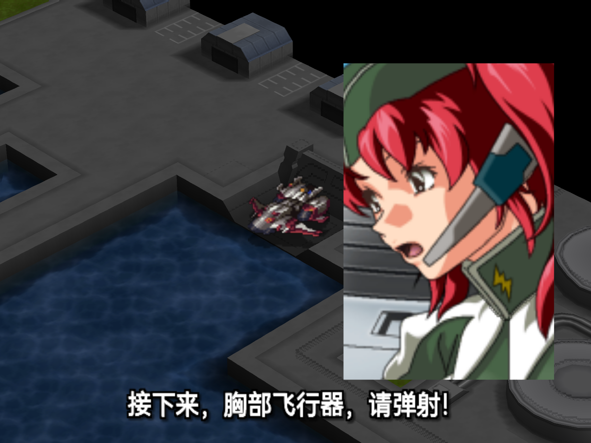
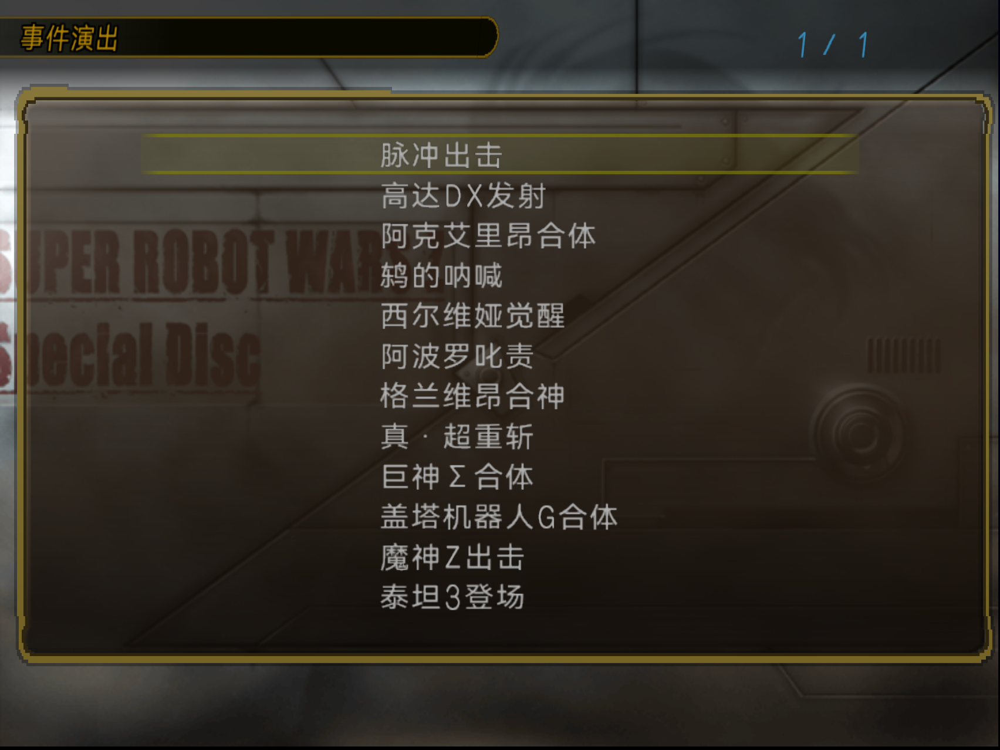
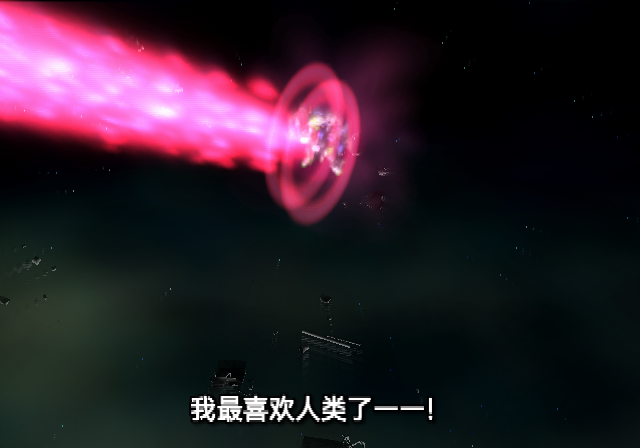

# SP 事件演出字幕与列表调整进度（2026-10-13）

最新字幕版本为[第七版画质调整](SP_EVENT_SUBTITLE_QUALITY_V7_20261013.md)：字号32，4倍显示尺寸渲染后直接平均缩到原生纹理，按1:1采样；白字黑描边、轻阴影、透明底、底部位置不变。37句润色文本和12个标题未改写。鉴赏完整性按用户要求暂缓，具体差异已整理到[完整性待办](SP_EVENT_COMPLETENESS_BACKLOG_20261013.md)。第六版以下内容保留为历史。

此前[第六版舞台与字幕修复](SP_EVENT_STAGE_AND_SUBTITLES_V6_20261013.md)：魔神Z末尾换成原生地图单位并在返回后完整恢复单位/驾驶员数据；补齐其他四项模型初始状态。37句使用润色稿，12标题采用用户确认版，字幕恢复4倍渲染再缩回流程。LRPS2冷启动13轮覆盖全12项通过；第六版扫描候选现已由第七版字幕改版替代。第五版定向验证与此前版本的记录保留为历史，不替代第六版证据。

第四版历史记录见[第四版修复候选](SP_EVENT_GALLERY_FIXES_20261013.md)：修复阿克艾里昂原图被字幕覆盖及点击条目时列表文字变形，已完成14轮LRPS2自然播放返回，覆盖12项；用户指定本轮使用LRPS2验收，要求的验证已通过；第四版未做ARMSX2人工验收。下文第三版检查和用户反馈保留为历史记录。

全部12段已有中文字幕草稿，共37句：其他11段新增33句，脉冲保留4句。第四版候选曾完成14轮原生输入的自然播放及返回，覆盖全部12项。字幕文稿仍待用户逐句听校，不能将识别结果视为译文审核通过。

## 听校交付物

- [离线逐句听校页面](issue-assets/sp-event-subtitles-20261013/review.html)：内嵌37段原音，可修改中文、勾选核对状态并导出JSON，不自动写回。标题及渲染元数据更新后源哈希改变，页面兼容此前润色稿哈希下的浏览器听校进度，原勾选和编辑内容可继续使用。
- [双语听校文稿](SP_EVENT_SUBTITLES_REVIEW_20261013.md)：日文整理候选、中文草稿、时间轴、术语ID及听校疑点。
- [字幕源](../config/products/special-disc/event-subtitles.json)：分别保留Whisper原始输出与整理候选，记录术语来源和待审核状态。

原音从现用汉化SP的CCC资源中提取，在本地用Whisper large-v3识别，没有调用云端转写。37个原音、网页内嵌音频、字幕源哈希和时间区间已核对；现有全局术语表和剧情语料未改写。

重点听校项包括瑟利安、阿波罗尼亚斯、合神超重斩、パイルダー的中文称呼，以及万丈台词中“恐れる／恐れぬ”的否定。短喊声的整理候选与识别原文分开保留，疑点已逐句标出。

## 界面与字幕

字幕字号由22增至26；640×448画面的显示范围为x64～576、y388～428，底部居中。白字、黑描边及阴影，字外透明，无黑底；在原生画面处理之后用屏幕坐标绘制，不受地图遮挡。

列表一页12项，保留原字体大小，压缩行距；同步原生输入用的条目数，末项“泰坦3登场”可正常选中。文字位置固定到整数坐标，静止截图清晰；用户随后确认在列表中点击任意演出、进入播放时，文字仍会瞬间向下拖影、模糊或扭曲，进入播放的过渡问题尚未解决。入口说明为“重温出击、合体等剧情名场面，播放结束后自动返回。”

## 运行问题与修复依据

美玲无声与巨神Σ加载时破坏内存有共同原因：资源重打包漏写末尾的结束偏移。原生读取器对最后一条记录也用“下一偏移减当前偏移”算长度。脉冲的CCC因此被跳过，巨神Σ则按错误的超大长度复制。重打包现已补齐结束表项；七条及八条记录包的原生长度规则回归检查通过。原生解压输入和解码后RAM核对支持这一结论，之前的栈、ELF overlay及压缩器猜测未获支持，未作为修复依据。

最终候选的[脉冲运行录音](issue-assets/sp-event-subtitles-20261013/runtime-final/impulse-runtime-16k.wav)经本地Whisper识别，包含四段美玲台词；[转写](issue-assets/sp-event-subtitles-20261013/runtime-final/impulse-runtime-asr.txt)末尾重复识别“腿部飞行器”，不能据此判断实际播放次数。静态原音、原生时间轴、运行录音分别留存。

鸫的字幕发灰与残影来自原生两个帧缓冲交替做屏幕反馈，字幕被下一帧当成背景再扭曲。现于反馈读取前临时还原无字幕背景，读取后恢复显示，再在最终画面叠加字幕；构建检查预留VRAM区域不与该演出纹理重叠。LRPS2连续三帧均可见清晰白字，无旧字幕残影。

格兰维昂两段的4位纹理页序已修正，字幕清晰。巨神Σ复测已采集三个正确时间窗内的字幕，并自然返回；较早误拍在开场等待期的截图不作为字幕显示依据。

## 验证范围

- 静态：原动画、语音及模型记录、非目标纹理像素保留；ELF与资源边界检查、字幕区间检查通过。新增2个记录包回归测试通过。
- ISO：ISO9660、UDF、VMAP同步及ELF/AID/VEFF回读通过，最终构建记录见[receipt](issue-assets/sp-event-subtitles-20261013/runtime-final/build-receipt.json)。
- LRPS2：最终ISO冷启动，隔离的记忆卡副本，原生控制器输入；14轮完整流程覆盖12项，均自然结束、返回，并保留上次播放项。无宿主内存写入、存档加载或直接函数调用干预。见[流程报告](issue-assets/sp-event-subtitles-20261013/runtime-final/flow-report.json)、[命令日志](issue-assets/sp-event-subtitles-20261013/runtime-final/commands.jsonl)、[来源记录](issue-assets/sp-event-subtitles-20261013/runtime-final/provenance.json)。
- ARMSX2：原生ARM64、Metal 6倍分辨率，冷启动最终候选；已人工确认入口、说明、单页12项、脉冲字幕及自然返回。解锁后已从扫描列表冷启动第三版，补验鸫的反馈扭曲段：字幕清晰，消失后无字影残留，演出自然返回并保留选中项。见[人工来源记录](issue-assets/sp-event-subtitles-20261013/armsx2-final/provenance.json)。全部12项的硬件逐句验收尚未完成。

## 第三版历史交付与回退

第三版曾位于ARMSX2扫描路径，现已移至`work/iso/archive/sp-event-gallery-subtitles-v3.iso`。当前扫描候选为第七版，精确哈希及路径见页首链接。

- ISO SHA-256：`b2f496cf49b95d4ec0d48fa27ddf2720029bcef76ccd8f17508f499a92c0870e`。
- ELF SHA-256：`40c842ad1dcef988e43ec6ac11c219c42150f8eecfb9e2eb208e014d66e2aedf`。
- 旧UI第二版移到扫描路径外：`work/iso/archive/sp-event-gallery-ui-v2.iso`，保留回退；旧兼容路径指向该文件。
- `work/iso/sp-event-gallery-review.iso` 是新版兼容链接。仅清理本轮自己的诊断ISO副本，操作见[文件整理记录](issue-assets/sp-event-subtitles-20261013/runtime-final/install-receipt.json)。
- 生产SP `build/iso/special-disc/sp-current.iso` 保持不变，SHA-256：`20414b4f10e5c46e1622e548447633ebcb3848998a544ef5ac03c022224996ba`。

## SP与本篇的差异

[逐资源比较](SP_EVENT_RESOURCE_COMPARISON_20261013.md)确认：当前12项涉及13个effect，原动画、贴图、模型和触发帧与Original本篇相同，主要区别为CCC编号重排。37段实际语音中36段字节一致，唯一不同为巨神Σ“充能”口令的音频长度及编码；尚不能据此断言台词或录音改变。现用汉化SP的这13个effect及37段原音均与日版SP一致。

资源一致不等于鉴赏已完全复刻原关卡。部分舞台指令已移植，部分单位、初始镜头和BGM还需原关卡逐段对照；这些构图差异不能归因于SP换了effect。本轮未commit或push。

## 用户逐项检查时的历史记录（第四版处理结果见页首）

用户要求先等逐项播放检查，暂不修改ISO或继续排查。当前分别记录：

- 用户澄清：在列表中点击任意演出、进入播放时，列表文字都会向下拖影、模糊或扭曲一下，不限定某个effect。之前将触发点写作“刚打开事件列表”不准确，现更正为点击条目进入播放的过渡。此前静止截图不足以证明这段过渡正常，此项未解决。
- 播放返回后，列表金色外边框及四角偶发抖动，并非每次出现。已采集帧间变化，具体触发演出和原因尚未确认，不能直接归因于入场动画、尺寸插值或GS状态。

待用户完成逐项检查后，依据具体条目和触发步骤继续定位。第三版ISO保持原样。

用户补充的[文字异常截图](issue-assets/sp-event-subtitles-20261013/user-ui-check/list-text-distortion-gravion-selected.png)已保存：列表字形可见横向错层和重复笔画，当前选中“格兰维昂合神”。截图本身不能确定此前播放条目或触发时刻；保持待逐项检查，不据此认定格兰维昂为原因。

触发条件补充：用户明确表示“是点击进入触发，随便哪个都会”。按列表任意条目点击进入播放可触发记录，不再把具体演出列为复现前提；根因尚未定位，继续遵照用户要求等待逐项检查。
