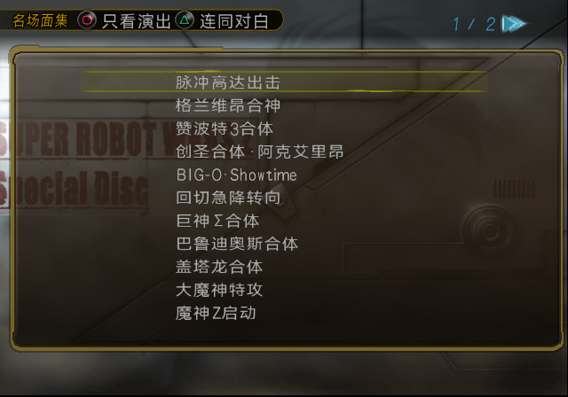
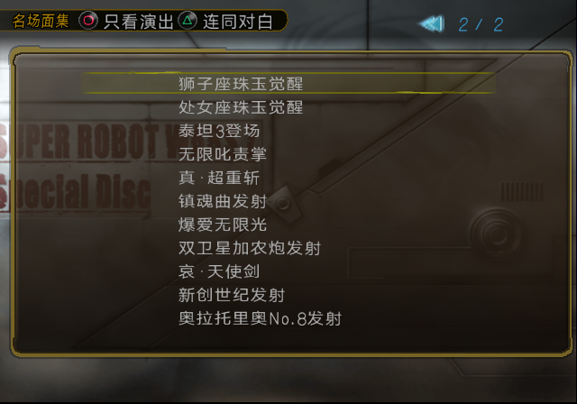

# SP 名场面集字体与标题（2026-11-05，最终确认版）

用户确认：数字稍大且底部对齐；汉字段显式设置完整尺寸；Showtime 分段调整后以 o 的可见底边为准，w 和 time 与之对齐。此前的分段候选均被本版取代。

## 构建实现

- 汉字/全宽段明确设置宽 20、推进 20、高 9，窄距段之后也恢复这三个值。
- 数字记录高度 8、Y 加 1，包生成时只把顶部上扩半个原生单位，有效高度 8.5，底边与中文对齐。
- 作者配置仍写普通 `BIG-O·Showtime`。菜单编码时替换私有 ti 合字和 w；m/e 使用原生字形（它们本来就与 o 同底）。
- ti 使用空槽 110（81AE，U+E100），放在 0x821d00。t/i 以源字模第 20 行为底；t 顶部缩短两行，保留已确认的横笔和底部。
- w 使用空槽 113（81B1，U+E103），放在 0x821400。将源笔画纵向 15 行调整为与 o 一致的 13 行，范围 8～20，横向不变。菜单分配上限为 0x1400，防止覆盖字形。
- 两个槽必须未分配且原字模为空，否则构建拒绝；共享 VT1 字库不修改。原生上传 hook 只替换这两个槽，其他字符使用原指针。
- 两个标题改为「狮子座珠玉觉醒」「处女座珠玉觉醒」。

完整控制符（十六进制；换行仅便于阅读，方括号代表私有单字符）：

```text
<width:0E><space:0A><height:09>BIG-O·
<width:14><space:14><height:09>
<width:0E><space:0A><height:09>Sho
<width:0E><space:0C><height:09>[w]
<width:10><space:0C><height:09>[ti]
<width:10><space:0C><height:09>m
<width:0E><space:0A><height:09>e
<width:14><space:14><height:09>
```

## 验证与证据边界

- 35 项名场面单元测试通过：字形槽冲突拒绝、源笔画和目标底边、显式控制、动画编译/布局等。
- 最终 ISO 的两个私有字形回读与构建结果一致；抽取的实际 MIPS hook 通过 47 个 Unicorn 指令用例，涵盖数字范围隔离、原指令恢复、两个私有槽及其他槽。
- ARMSX2 runner / SW 从最终 ISO 冷启动，无 RAM 注入、无即时存档加载；第一页、第二页、返回第一页、退出剧场和重入检查通过。
- 正式 ISO 的 Showtime 截图区域与用户确认的最后候选逐像素相同。
- 动画回归：格兰维昂和双卫星加农炮各自的 ○ / △ 模式均自然播完返回菜单，编队 0x76940 字节逐字节恢复。截图确认格兰维昂带台词版的四队和双 X 修正后画面。
- 以上是 ARMSX2 runner、静态与 ISO 回读证据，不是 PCSX2/manual 验收，也不代表此次重新逐项验收全部 22 段演出。动画修复的完整历史见 `SP_EVENT_GALLERY_VS_EVENT_MOVIE_20261026.md`。

最终证据：`docs/issue-assets/sp-gallery-final-20261105/`。构建身份以 `manifests/editions/sp/current.json` 为准，ISO 保存在 `build/iso/special-disc/sp-current.iso`，不纳入 Git。




